# GRC102 Practical Lab 8 — Monitoring, Auditing Controls and Executive Reporting

**Learner:** Adaeze Elizabeth Adeteye  
**Course:** GRC102 Information Security Governance (ICDFA) — individual practical lab, 100 marks  
**Scenario:** An isolated Docker simulation modelled on the governance failures behind the Equifax breach  
**Official instructions:** [ICDFA LAB_INSTRUCTIONS.md](https://github.com/icdfa/grc-engineering-labs/blob/master/phase1/grc102/week8/LAB_INSTRUCTIONS.md)  
**Evidence report (PDF):** [GRC102_Lab8_Evidence_Report.pdf](GRC102_Lab8_Evidence_Report.pdf)  
**Environment:** Kali GNU/Linux Rolling 2025.1 · Docker 28.5.2 · Docker Compose 2.40.3 · Python 3.13.2

> **Safety and scope.** Everything here runs only inside my local, isolated Docker network. I did not scan or test any public, organisational or third-party system. All customer data is fictitious.

---

## Evidence status (please read first)

| Item | Status |
|---|---|
| Environment setup and troubleshooting screenshots | Done — [Part 1](#part-1--setting-up-a-simulated-environment) |
| Governance tracker baseline and dashboard | Done |
| Control implementation and verification output | Done (recorded in state files, see limitations in [Part 3](#part-3--implementing-governance-controls)) |
| Metrics, dashboard, board report, charts | Done (trend history is simulated, see [Part 4](#part-4--metrics-and-executive-reporting)) |
| Live vulnerability scan, attack-simulation log, post-patch re-scan | **Pending** — needs the containers running. Steps are in [REPRODUCTION.md](REPRODUCTION.md). I have not invented output for these. |

---

## Repository map

| Area | Files |
|---|---|
| Environment | [docker-compose.yml](docker-compose.yml) · [database_init/init.sql](database_init/init.sql) · [evidence/part1_environment/](evidence/part1_environment/) |
| Part 1 | [vulnerability_scanner.py](vulnerability_scanner.py) · [initialize_governance.py](initialize_governance.py) · [governance_tracker.py](governance_tracker.py) · [patch_management.py](patch_management.py) · [baseline_dashboard.json](baseline_dashboard.json) · [governance_data.json](governance_data.json) |
| Part 2 | [simulate_attack.py](simulate_attack.py) · [analyze_governance_failures.py](analyze_governance_failures.py) · [equifax_comparison.md](equifax_comparison.md) |
| Part 3 | [implement_governance_controls.py](implement_governance_controls.py) · [governance_controls_report.md](governance_controls_report.md) · [governance_oversight.md](governance_oversight.md) · [patch_status.json](patch_status.json) · [monitoring/security_monitor.sh](monitoring/security_monitor.sh) · [evidence/part3_controls/](evidence/part3_controls/) |
| Part 4 | [governance_metrics.py](governance_metrics.py) · [executive_dashboard.html](executive_dashboard.html) · [board_report.md](board_report.md) · [governance_metrics_framework.md](governance_metrics_framework.md) · [dashboard_user_guide.md](dashboard_user_guide.md) · [metrics_visualizations/](metrics_visualizations/) · [evidence/part4_dashboard/](evidence/part4_dashboard/) |

---

## Part 1 — Setting Up a Simulated Environment

I built three containers on one flat bridge network, `secgov_network`:

- **web_server** — a deliberately vulnerable Apache Struts 2 app (`vulhub/struts2:2.3.30`)
- **database_server** — MySQL 5.7 holding a fictitious `customers` table (SSN, date of birth, card number) with weak `root`/`password` credentials
- **monitoring_server** — a bare Ubuntu container that only runs `tail -f /dev/null`

### My setup evidence

| Screenshot | What it shows |
|---|---|
| 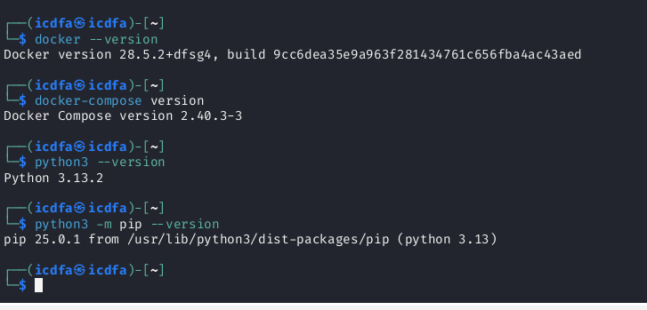 | Docker 28.5.2, Compose 2.40.3, Python 3.13.2 |
| 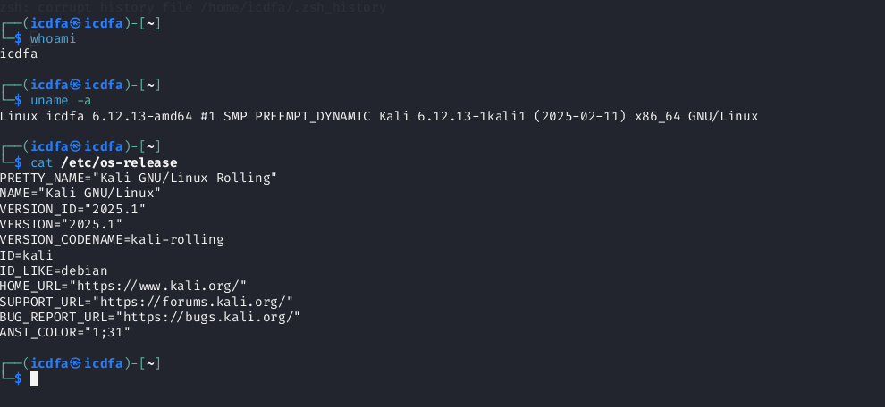 | Kali GNU/Linux Rolling 2025.1 host |
| 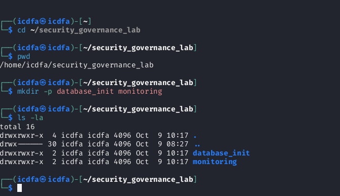 | Lab directories created |

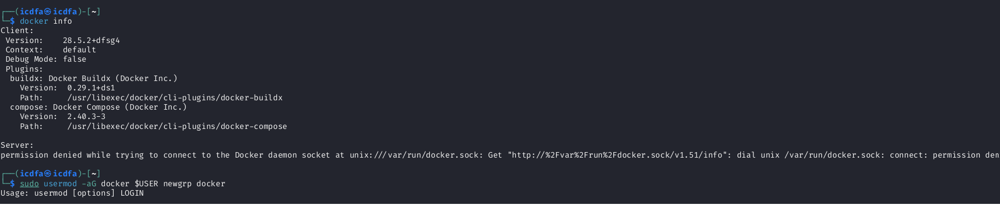

*`docker info` hit `permission denied` on the Docker socket. I diagnosed a group-membership problem and ran `sudo usermod -aG docker $USER`. My first attempt chained `newgrp docker` onto the same line, so usermod printed its usage text; the change needs a fresh login.*

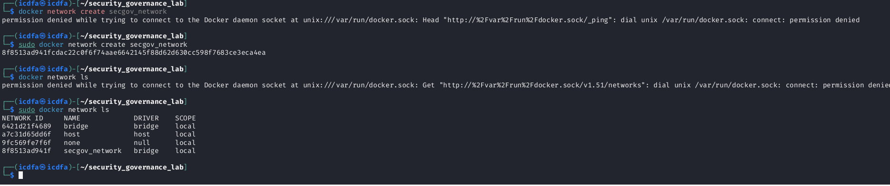

*Network creation failed without sudo and succeeded with it; `docker network ls` confirms `secgov_network`.*

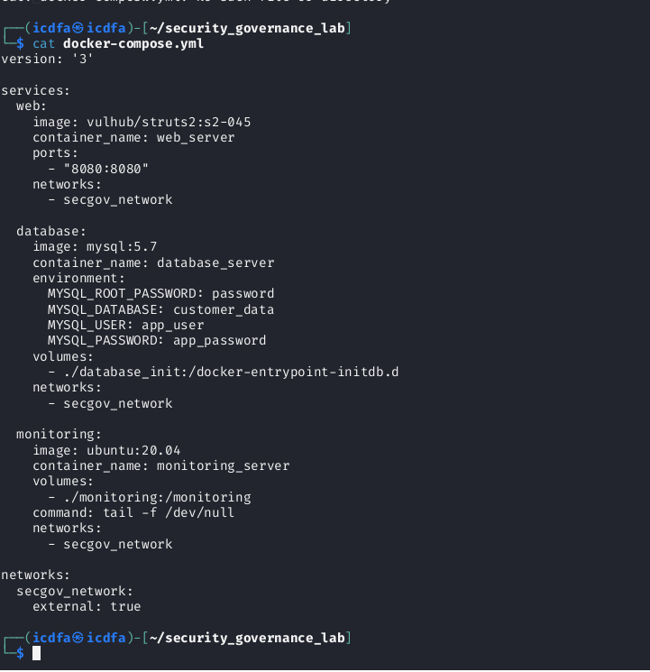
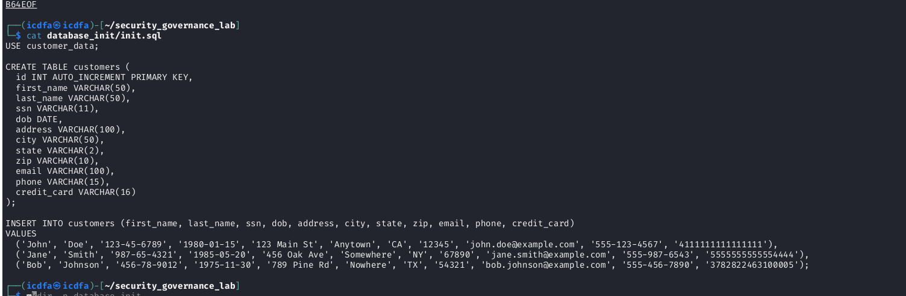

### A bug I found in the official instructions

`docker compose up -d` failed with `manifest for vulhub/struts2:s2-045 not found`.

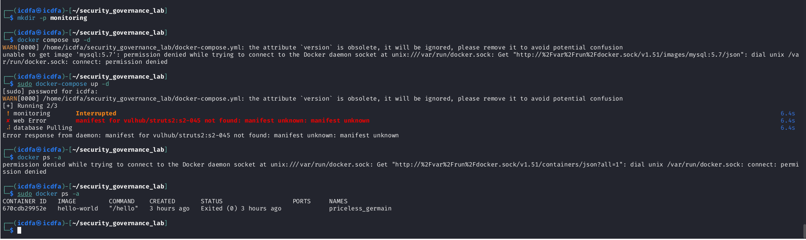

This is not a permissions problem. The [vulhub/struts2 tag list on Docker Hub](https://hub.docker.com/r/vulhub/struts2/tags) has version tags such as `2.3.28`, `2.3.30` and `2.5.25`, and advisory tags such as `s2-053`, `s2-066` and `s2-067`, but no `s2-045`. I changed my compose file to `vulhub/struts2:2.3.30`, a Struts 2.3 release in the range affected by [CVE-2017-5638](https://nvd.nist.gov/vuln/detail/CVE-2017-5638) / [Apache S2-045](https://cwiki.apache.org/confluence/display/WW/S2-045), the same flaw Equifax left unpatched.

I also changed the scanner and attack scripts to target `http://localhost:8080` (override with `TARGET_URL`), because the original `http://web_server:8080` hostname only resolves inside the Docker network and would fail from my Kali host.

### Governance baseline

I initialised the tracker and exported [baseline_dashboard.json](baseline_dashboard.json): 3 policies, 3 controls, 3 risks (1 Critical, 1 High, 1 Medium), 1 incident, 3 metrics. I fixed a bug in the original status logic that marked *Remediation Time* (12 days vs a 7-day target) and *Security Incidents* (1 vs 0) as Green. All three baseline metrics are now correctly Red.

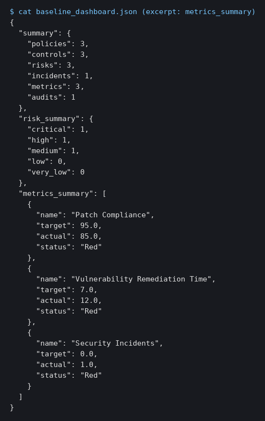

### How this reflects the Equifax conditions

I reproduced the *structural* causes, not just the exploit: a known Struts CVE left unpatched, a flat network between the web tier and customer data, default database credentials, a monitor that detects nothing, and a Patch Management Policy (POL-001) that exists on paper while compliance sits at 85% against a 95% target. The [GAO review (GAO-18-559)](https://www.gao.gov/products/gao-18-559) and the [House Oversight Committee report](https://oversight.house.gov/wp-content/uploads/2018/12/Equifax-Report.pdf) describe the same pattern.

---

## Part 2 — Analysing Governance Failures

- [simulate_attack.py](simulate_attack.py) sends a harmless S2-045 probe (it only adds a response header) to my lab container and logs the result to `attack_log.json`.
- [analyze_governance_failures.py](analyze_governance_failures.py) correlates scan, attack, tracker and patch data into categorised failures.
- [equifax_comparison.md](equifax_comparison.md) is my full comparison.

| # | Failure | Evidence in my lab |
|---|---|---|
| 1 | Patch management | Unpatched Struts 2.3.30; patch compliance 85% vs 95% |
| 2 | Policy implementation | POL-001 Active, but baseline metrics Red |
| 3 | Vulnerability management | Remediation 12 days vs 7-day target |
| 4 | Security architecture | Web and database share one flat network |
| 5 | Authentication | `root`/`password` seeded in compose |
| 6 | Incident detection | Monitor does nothing at baseline |
| 7 | Metrics | Recorded but not tied to escalation |

**What I learned:** a governance failure is a chain, not one missing control. The Struts flaw only becomes a governance failure alongside an unenforced policy, a silent monitor and a flat network. And metrics without enforcement are decorative: my baseline already showed 85% patch compliance, and nothing routed that gap to an accountable owner.

---

## Part 3 — Implementing Governance Controls

| Control | What I implemented | Failure it closes |
|---|---|---|
| CTL-004 Automated Patch Management | PATCH-001 applied, 7-day SLA, MET-004 | Patch management, policy gap |
| CTL-005 Network Segmentation | PATCH-003 recorded, direct web-to-DB access removed | Lateral movement |
| CTL-006 Database Security | PATCH-002 recorded, defaults replaced | Weak authentication |
| CTL-007 Real-time Monitoring | [security_monitor.sh](monitoring/security_monitor.sh) on a 5-minute cron, MET-005 | Detection gap |
| CTL-008 / POL-004 Executive Oversight | Named CEO, CISO, CIO, CFO in [governance_oversight.md](governance_oversight.md) | No accountable owner |

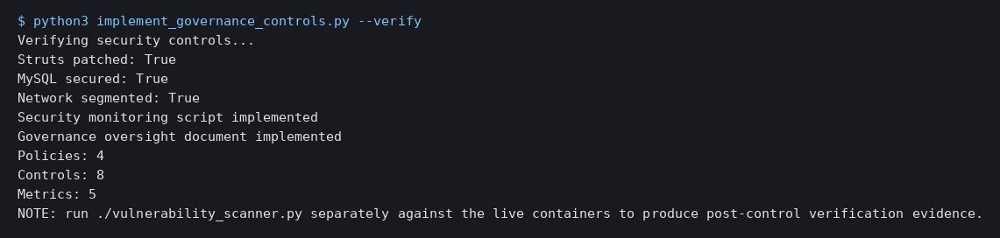
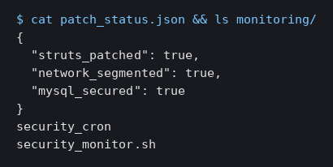
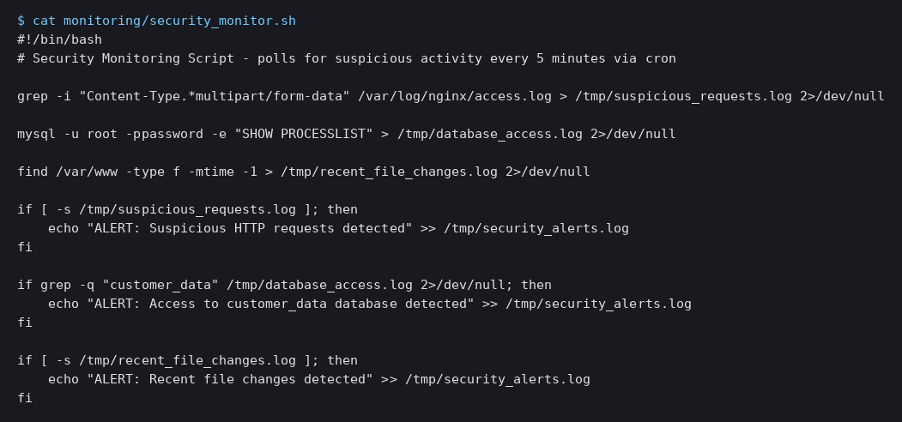

Full detail: [governance_controls_report.md](governance_controls_report.md). The approach follows [NIST SP 800-40 Rev. 4](https://csrc.nist.gov/pubs/sp/800/40/r4/final).

### Limitations I am disclosing

1. **State, not containers.** Patch, segmentation and database controls are recorded in `patch_status.json` and the governance register. They do not yet reconfigure the running containers, so this proves governance tracking, not technical remediation.
2. **Credential in my monitor.** `security_monitor.sh` embeds `mysql -u root -ppassword`, which contradicts CTL-006. This is a residual finding: it should use a read-only monitoring account and a secret store.
3. **Live proof outstanding.** The decisive check is a post-control re-scan showing Struts no longer returns the exploit header (see [REPRODUCTION.md](REPRODUCTION.md)).

---

## Part 4 — Metrics and Executive Reporting

- [governance_metrics.py](governance_metrics.py) generates the dashboard, board report and five charts.
- [executive_dashboard.html](executive_dashboard.html) — open in a browser.
- [board_report.md](board_report.md) · [governance_metrics_framework.md](governance_metrics_framework.md) · [dashboard_user_guide.md](dashboard_user_guide.md)

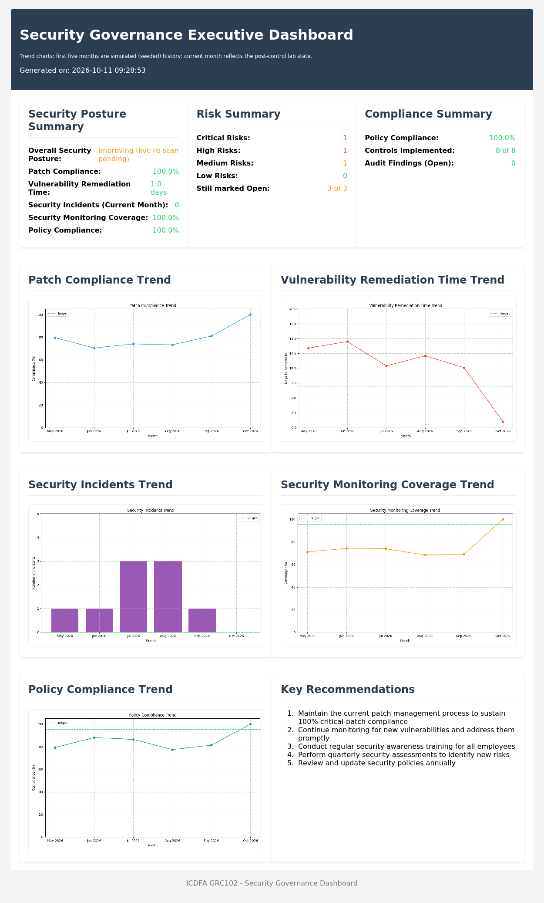

| Chart | |
|---|---|
| 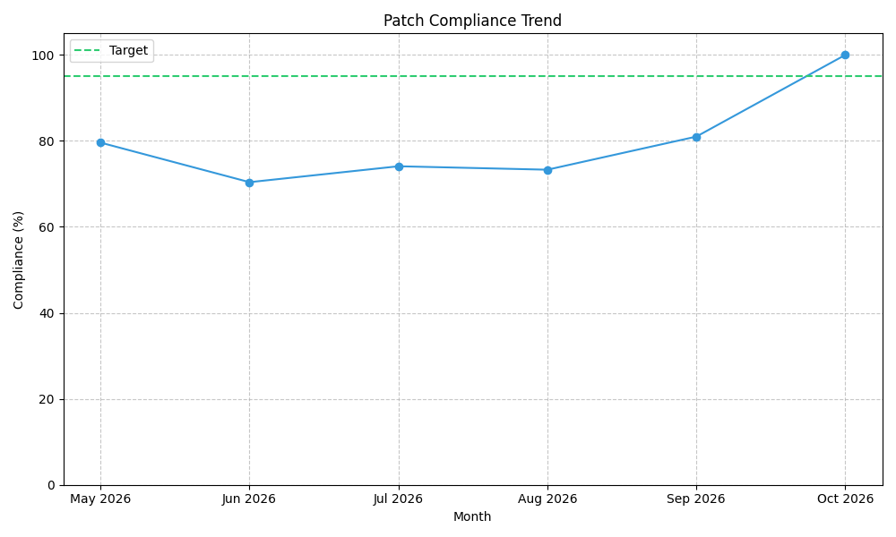 | 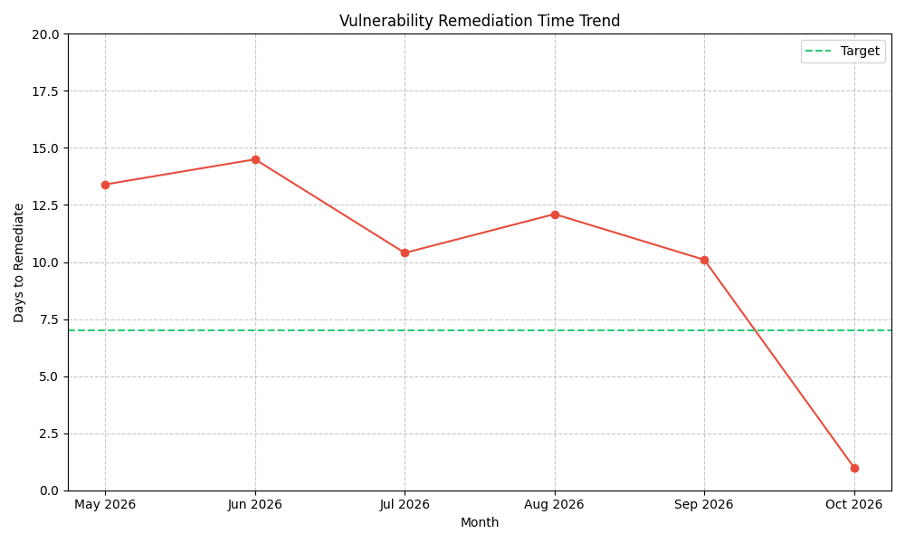 |
| 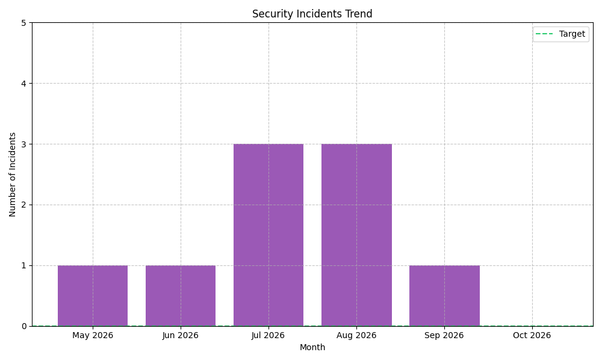 | 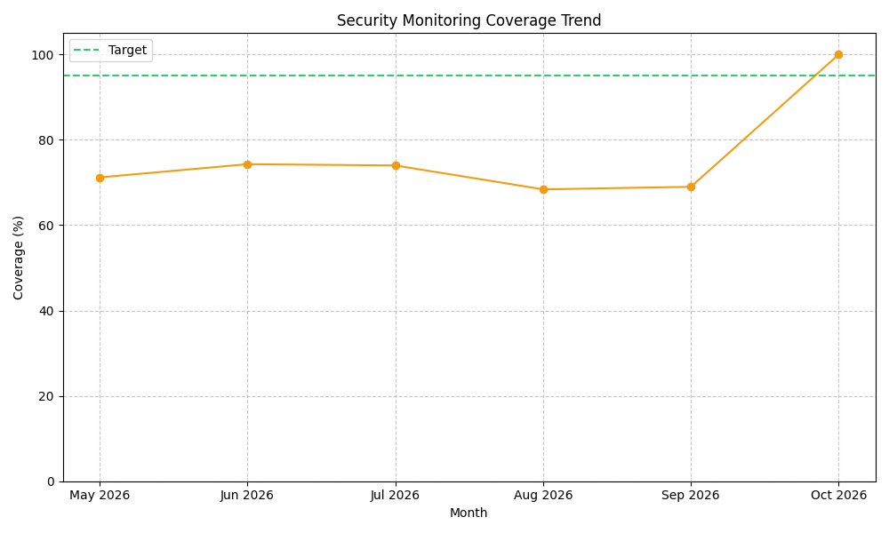 |
| 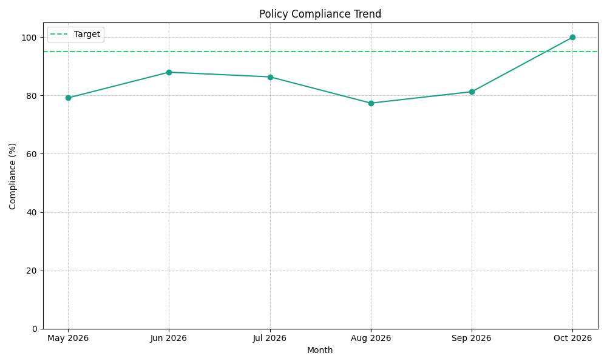 | |

**Honest labelling.** The five months of history are simulated with a fixed random seed, because a lab created this week has no real telemetry. The current month reflects the post-control lab state. The dashboard says so on its face.

**Corrections I made to my first version:** risk counts and "control effectiveness" were hard-coded and are now read from `governance_data.json`; "Overall Security Posture: Good" became "Improving (live re-scan pending)" because one Critical and one High risk are still Open; and the board report no longer claims risks are resolved.

**How this supports oversight:** the dashboard turns raw tracker data into red/green against a target, a trend and a named owner, which a non-technical director can act on in a minute. That is the layer that failed at Equifax, where technical findings never reached people able to act. Because every metric has a defined formula, owner and category, a reviewer can see *why* a number moved. I also recommend independent validation, since my current values are self-reported.

---

## References

- Apache Software Foundation, [S2-045 security bulletin](https://cwiki.apache.org/confluence/display/WW/S2-045)
- NIST, [CVE-2017-5638](https://nvd.nist.gov/vuln/detail/CVE-2017-5638)
- U.S. GAO (2018), [GAO-18-559](https://www.gao.gov/products/gao-18-559)
- U.S. House Oversight Committee (2018), [The Equifax Data Breach](https://oversight.house.gov/wp-content/uploads/2018/12/Equifax-Report.pdf)
- NIST, [SP 800-40 Rev. 4](https://csrc.nist.gov/pubs/sp/800/40/r4/final)
- Vulhub, [vulhub/struts2 tags](https://hub.docker.com/r/vulhub/struts2/tags)

## Academic integrity

This is my individual work. External sources are cited above. Scripts follow the ICDFA lab instructions, with the fixes I describe in this README.
