# Lab 1: Practical Vulnerability Assessment for GRC Professionals

| | |
|---|---|
| **Author** | Adaeze Elizabeth Adeteye |
| **Student ID** | C11/26/CGRCE/17561 |
| **Programme** | ICDFA |
| **Course / Week** | GRC103, Week 1 |
| **Assessment date** | 20 October 2026 |
| **Role** | Internal auditor (GRC Audit Team) |
| **Target** | Metasploitable2 test server, `192.168.56.10` |
| **Attacker machine** | Kali Linux, `192.168.56.20` |
| **Tools** | Nmap 7.95, Nikto 2.6.1, Nuclei 3.11.1 (templates v10.5.0), xsltproc |

> **Scope and ethics.** Everything in this report was done against an intentionally vulnerable virtual machine in an isolated lab network that I was authorised to test. I identified and documented weaknesses. I did not exploit any of them.

---

## Contents

1. [Overview](#1-overview)
2. [Environment and tool check](#2-environment-and-tool-check)
3. [Phase 1: Discovery and enumeration](#3-phase-1-discovery-and-enumeration)
4. [Phase 2: Vulnerability identification](#4-phase-2-vulnerability-identification)
5. [Phase 3: Risk assessment (Step 6)](#5-phase-3-risk-assessment-step-6)
6. [Executive summary (Step 7)](#6-executive-summary-step-7)
7. [Remediation priorities](#7-remediation-priorities)
8. [Limitations and notes](#8-limitations-and-notes)
9. [Deliverables checklist](#9-deliverables-checklist)
10. [Repository structure](#10-repository-structure)

---

## 1. Overview

I was asked to assess a newly discovered test server (`metasploitable`) in the development environment. My objectives were to:

- discover the live host and identify open ports and services,
- enumerate software versions and identify known vulnerabilities,
- map the findings to NIST CSF, CIS Controls and PCI DSS,
- rate the risk of each finding, and
- report the results in a form management can act on.

## 2. Environment and tool check

Before scanning, I confirmed that Nikto, xsltproc and Nuclei were installed and working.

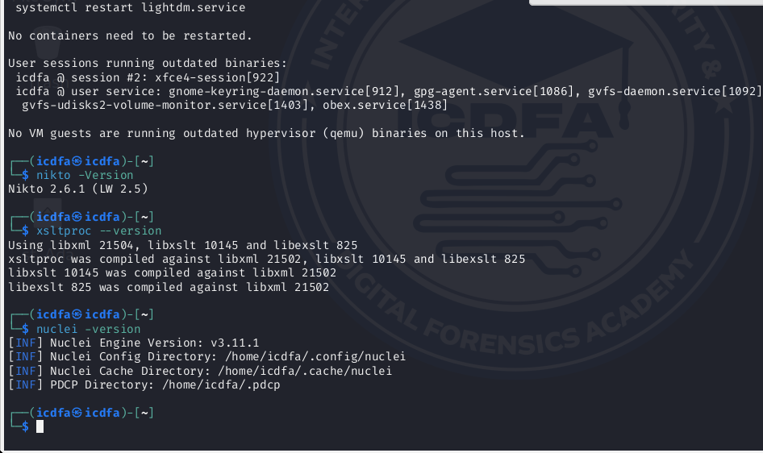

*Screenshot 01: Nikto 2.6.1, xsltproc (libxml 21504) and Nuclei v3.11.1 are all available.*

---

## 3. Phase 1: Discovery and enumeration

### Step 1: Network discovery

I pinged the target to confirm it was alive, and checked my own interface address with `ip a show eth1`.

```bash
ping -c 4 192.168.56.10
ip a show eth1
```

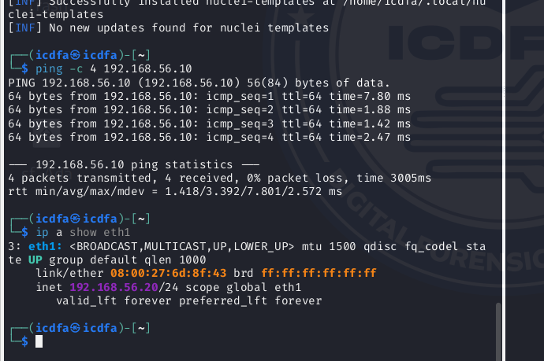

*Screenshot 02: 4 packets sent, 4 received, 0% packet loss. The target responds. My Kali machine is `192.168.56.20` on `eth1`.*

**GRC context:** This step supports asset inventory management (NIST CSF ID.AM-1, CIS Control 1). I cannot assess or protect a system I do not know exists.

### Step 2: Port and service enumeration with Nmap

I created a working folder and ran a full scan of all 65,535 ports with service detection, default scripts and OS detection. `-oA` saved the results in three formats.

```bash
mkdir ~/lab1 && cd ~/lab1
nmap -sV -sC -O -p- -oA initial_scan 192.168.56.10
xsltproc -o initial_scan_report.html /usr/share/nmap/nmap.xsl initial_scan.xml
```

The scan started at 13:35:33 and finished at 13:38:49 (196.09 seconds). The host was up with 0.0016 s latency. **30 ports were open and 65,505 were closed.**

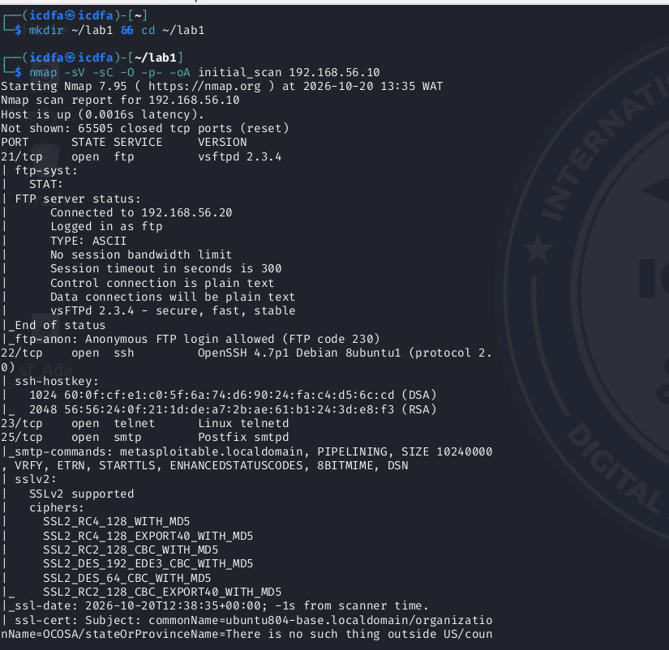

*Screenshot 03: The scan command and first results: vsftpd 2.3.4 with anonymous login allowed, OpenSSH 4.7p1, Telnet and Postfix SMTP with SSLv2.*

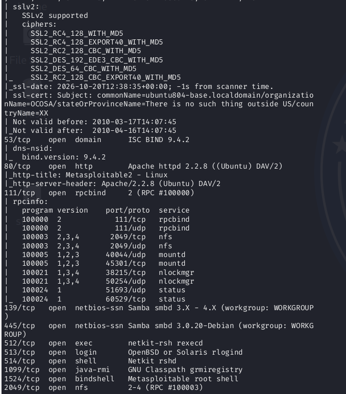

*Screenshot 04: BIND 9.4.2, Apache 2.2.8, RPC, Samba 3.0.20, rexec/rlogin/rsh (512-514) and a "Metasploitable root shell" on port 1524.*

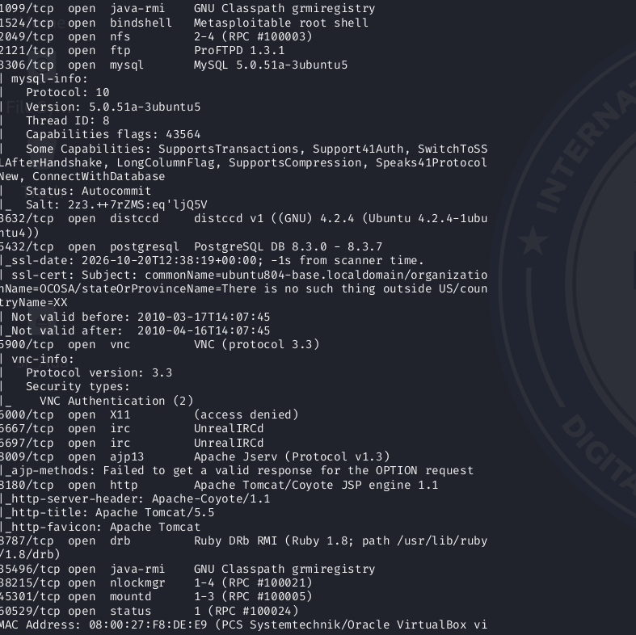

*Screenshot 05: ProFTPD 1.3.1, MySQL 5.0.51a, distccd, PostgreSQL 8.3.x, VNC, UnrealIRCd, Apache Jserv, Tomcat 5.5 and the remaining RPC ports.*

I then displayed the saved `initial_scan.nmap` file to confirm the output was written correctly.

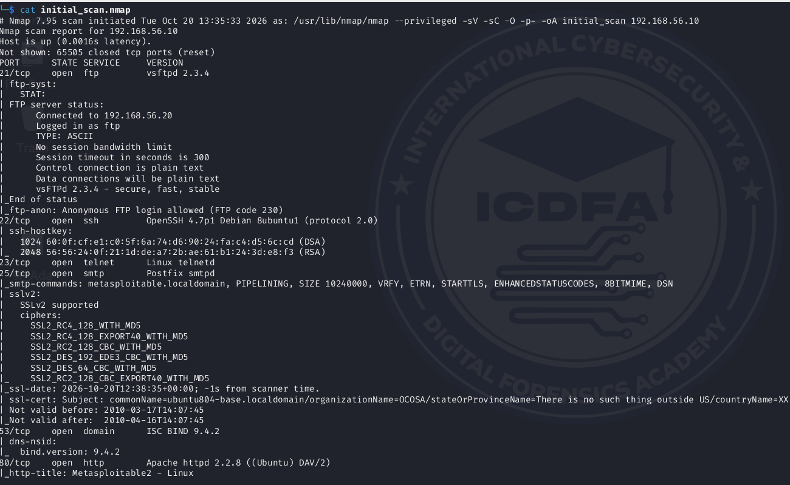

*Screenshot 06: `initial_scan.nmap` (first half), generated at Tue Oct 20 13:35:33 2026.*

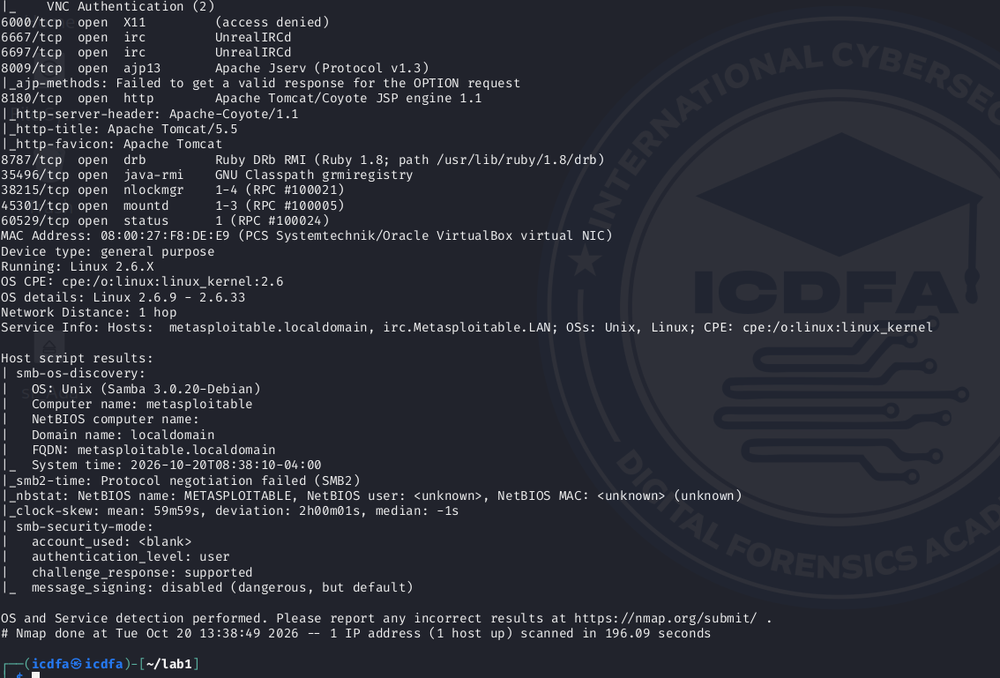

*Screenshot 07: `initial_scan.nmap` (second half): OS detected as Linux 2.6.9 - 2.6.33, MAC address belongs to a VirtualBox NIC, and SMB message signing is disabled.*

#### Nmap HTML report

I opened `initial_scan_report.html` in Firefox. The five screenshots below cover the whole report from top to bottom.

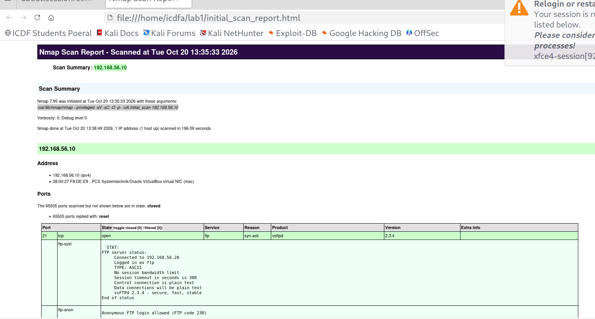

*Screenshot 08: Scan summary, command line, timing and the start of the port table.*

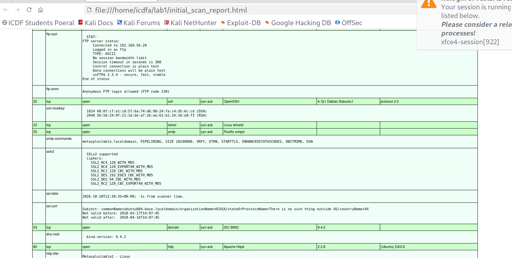

*Screenshot 09: Ports 21 to 80, including the SSLv2 ciphers and the expired certificate on SMTP.*

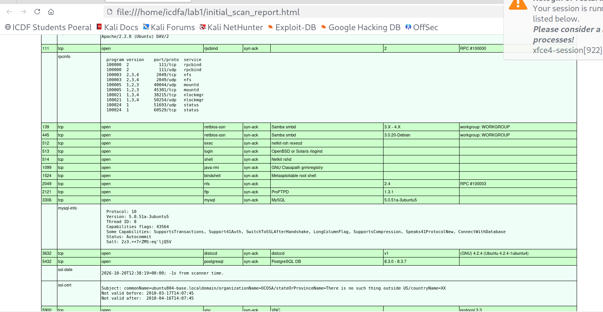

*Screenshot 10: Ports 111 to 5432, including Samba, r-services, the bindshell, NFS, MySQL, distccd and PostgreSQL.*

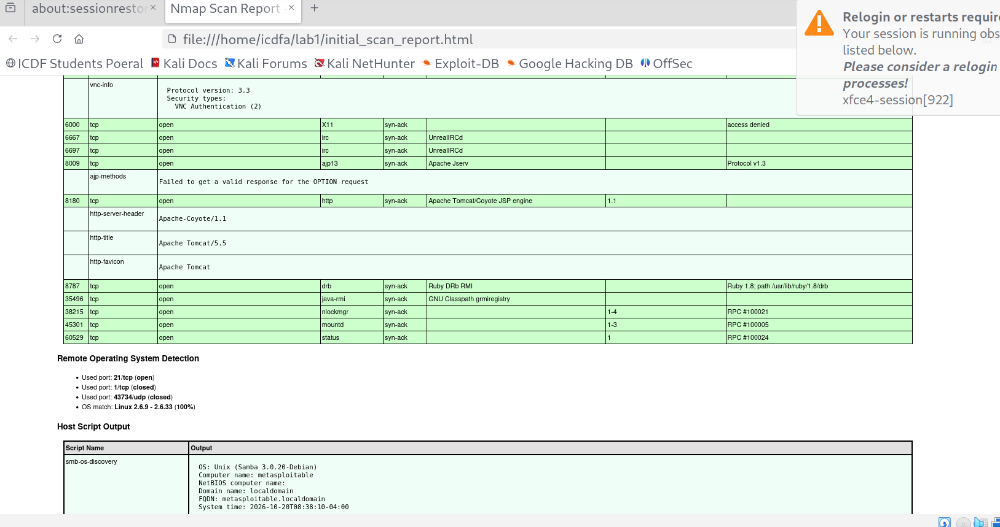

*Screenshot 11: Ports 5900 to 60529 and the remote OS detection result (Linux 2.6.9 - 2.6.33, 100%).*

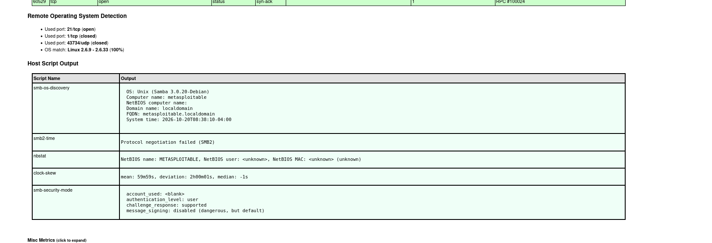

*Screenshot 12: Host script output, including `smb-security-mode` with message signing disabled.*

#### GRC question: why is knowing which ports are open a compliance issue?

Every open port is a service that can be attacked, so the list of open ports is a direct measure of the server's **attack surface**. Frameworks expect organisations to expose only what the business needs:

- **Unnecessary services.** CIS Control 9 (limitation and control of network ports, protocols and services) and NIST CSF PR.IP-1 / PR.PT-3 (secure baseline, least functionality) require unused services to be disabled. I found 30 open ports on one server. Telnet (23), rexec/rlogin/rsh (512-514), a root bindshell (1524), VNC and several database ports have no place on a hardened server.
- **Insecure protocols.** FTP and Telnet send credentials in clear text. That conflicts with data-in-transit protection (NIST CSF PR.DS-2) and with PCI DSS requirements to use only secure services and encrypt transmission.
- **Evidence of control failure.** Open legacy ports show that a hardening baseline was not applied or enforced, which is a governance gap, not just a technical one.
- **Audit trail.** The port list is evidence for asset inventory (ID.AM) and for demonstrating that vulnerability scanning is performed (NIST CSF DE.CM-8).

---

## 4. Phase 2: Vulnerability identification

### Step 3: Analysing the Nmap output

I recorded every service and version found. Items in bold are the ones I treated as most significant.

| Port | Service | Version / detail |
|---|---|---|
| 21 | ftp | **vsftpd 2.3.4**, **anonymous login allowed** |
| 22 | ssh | OpenSSH 4.7p1 Debian 8ubuntu1 (protocol 2.0), 1024-bit DSA host key |
| 23 | telnet | **Linux telnetd** |
| 25 | smtp | Postfix smtpd, **SSLv2 supported**, certificate expired in 2010 |
| 53 | domain | ISC BIND 9.4.2 |
| 80 | http | Apache httpd 2.2.8 (Ubuntu) DAV/2, page title "Metasploitable2 - Linux" |
| 111 | rpcbind | RPC #100000 |
| 139 | netbios-ssn | Samba smbd 3.X - 4.X |
| 445 | netbios-ssn | **Samba smbd 3.0.20-Debian**, **SMB message signing disabled** |
| 512 | exec | netkit-rsh rexecd |
| 513 | login | OpenBSD or Solaris rlogind |
| 514 | shell | Netkit rshd |
| 1099 | java-rmi | GNU Classpath grmiregistry |
| 1524 | bindshell | **"Metasploitable root shell"** |
| 2049 | nfs | 2-4 (RPC #100003) |
| 2121 | ftp | ProFTPD 1.3.1 |
| 3306 | mysql | MySQL 5.0.51a-3ubuntu5 |
| 3632 | distccd | distccd v1 ((GNU) 4.2.4) |
| 5432 | postgresql | PostgreSQL DB 8.3.0 - 8.3.7, expired certificate |
| 5900 | vnc | VNC (protocol 3.3), password authentication |
| 6000 | X11 | access denied |
| 6667, 6697 | irc | UnrealIRCd |
| 8009 | ajp13 | Apache Jserv (protocol v1.3) |
| 8180 | http | Apache Tomcat / Coyote JSP engine 1.1 (Tomcat 5.5) |
| 8787 | drb | Ruby DRb RMI (Ruby 1.8) |
| 35496 | java-rmi | GNU Classpath grmiregistry |
| 38215, 45301, 60529 | nlockmgr, mountd, status | RPC #100021, #100005, #100024 |

**Other observations:** the OS was identified as Linux 2.6.9 - 2.6.33 (100% match) running on a VirtualBox virtual NIC. The hostname is `metasploitable.localdomain`. All of these versions are many years out of support.

### Step 4: Web application assessment

#### Nikto

```bash
nikto -h http://192.168.56.10 -o nikto_scan.txt
```

Nikto sent 8,235 requests in 31 seconds (13:57:29 to 13:58:00) and reported **31 items with 0 errors**.

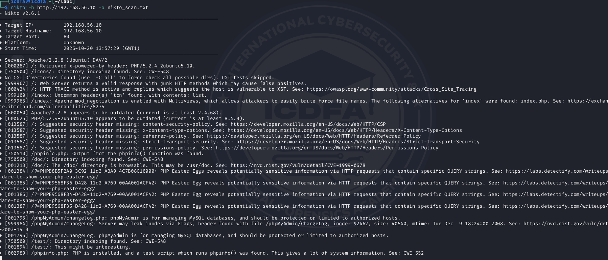

*Screenshot 13: Nikto command, target details and the first findings.*

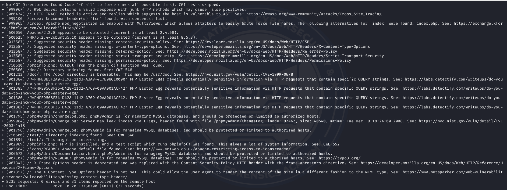

*Screenshot 14: Remaining findings and the summary line (8235 requests, 0 errors, 31 items).*

The findings I considered most important:

- Apache 2.2.8 and PHP 5.2.4 are outdated.
- The `X-Powered-By` header discloses the exact PHP version.
- Directory indexing is enabled on `/icons/`, `/doc/` and `/test/`.
- The HTTP TRACE method is enabled, which suggests exposure to cross-site tracing (XST).
- `/phpinfo.php` is exposed and reveals detailed system information.
- phpMyAdmin files (`ChangeLog`, `Documentation.html`, `README`) are reachable and should be limited to authorised hosts.
- Several PHP "Easter egg" query strings return information.
- `/phpMyAdmin/ChangeLog` leaks inode and file-size information through ETags.
- Security headers are missing: Content-Security-Policy, X-Content-Type-Options, Referrer-Policy, Strict-Transport-Security and Permissions-Policy.
- Apache `mod_negotiation` with MultiViews allows attackers to guess file names.

#### Manual inspection in Firefox

I opened `http://192.168.56.10` and explored the applications that the landing page links to.

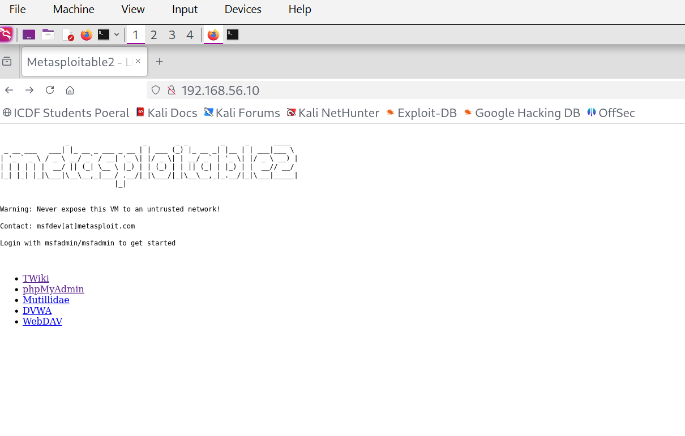

*Screenshot 15: The landing page links to TWiki, phpMyAdmin, Mutillidae, DVWA and WebDAV. It also displays the login hint `msfadmin/msfadmin` in plain view, which is a credential disclosure.*

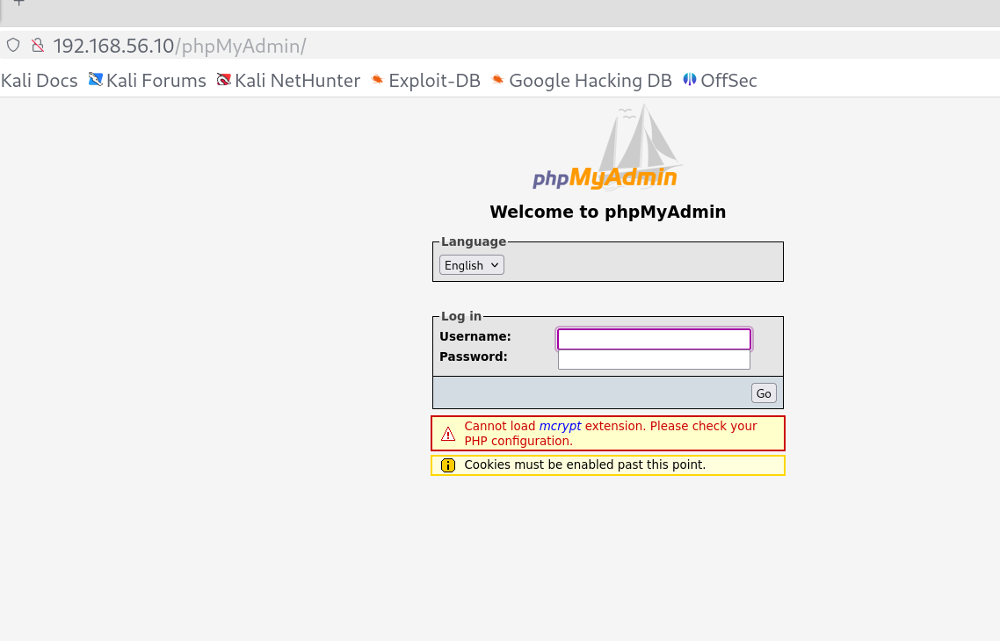

*Screenshot 16: The phpMyAdmin login page is publicly reachable and shows a PHP configuration error ("Cannot load mcrypt extension"). Verbose errors like this should not be shown to users.*

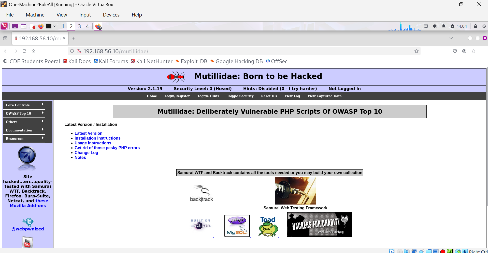

*Screenshot 17: Mutillidae, a deliberately vulnerable OWASP Top 10 application, running at Security Level 0 (Hosed) with hints disabled.*

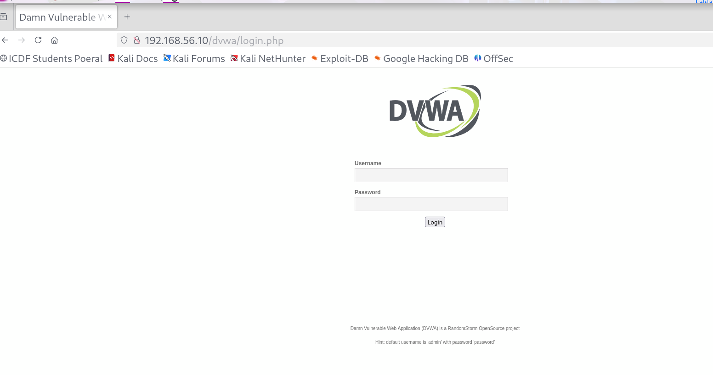

*Screenshot 18: The DVWA login page openly states the default username and password at the bottom of the page.*

**GRC context:** Web applications are a high-risk entry point. These findings align with the OWASP Top 10 (for example security misconfiguration and identification and authentication failures) and PCI DSS Requirement 6.

### Step 5: Focused vulnerability scanning with Nuclei

```bash
nuclei -update-templates
nuclei -u http://192.168.56.10 -o nuclei_web_scan.txt
```

Nuclei was already on the latest version (v3.11.1, templates v10.5.0). It loaded 11,144 templates, and the scan completed in about 2 minutes with **70 matches**. Counting the saved output file (`nuclei_web_scan.txt`), these break down as **4 critical, 18 high, 3 medium, 6 low and 39 informational**. Although I gave it a web URL, it also matched network-service templates (FTP, SSH, PostgreSQL, VNC, SMB, AJP) on the same host.

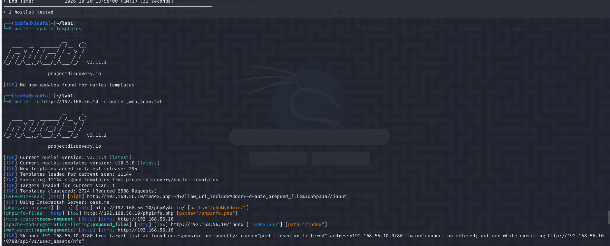

*Screenshot 19: Template update check, scan start and the first matches, including a high-severity PHP-CGI finding (CVE-2012-1823).*

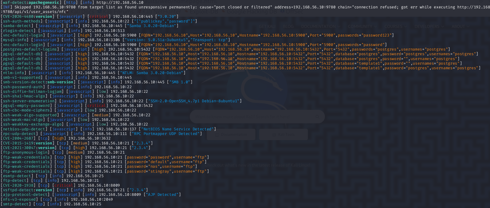

*Screenshot 20: Critical, high and medium findings on SMB, VNC, PostgreSQL, SSH, distccd, vsftpd and FTP.*

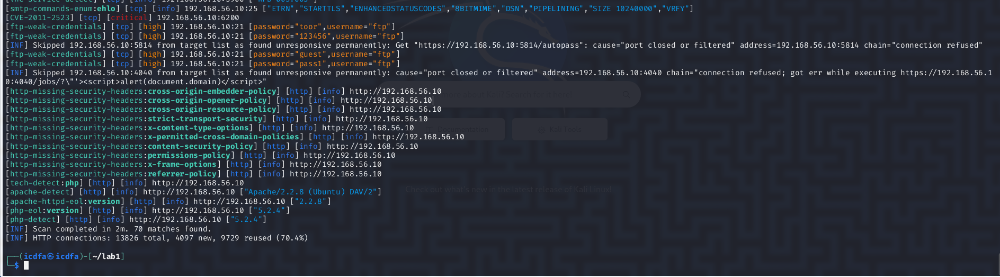

*Screenshot 21: The vsftpd backdoor (CVE-2011-2523), more FTP weak credentials, missing security headers, end-of-life Apache and PHP, and the scan summary (70 matches).*

The Nuclei results I used in the risk assessment:

| Severity | Template / CVE | Target |
|---|---|---|
| Critical | CVE-2011-2523 (vsftpd 2.3.4 backdoor) | 6200 |
| Critical | CVE-2020-1938 (Apache JServ / Tomcat AJP exposure) | 8009 |
| Critical | `pgsql-empty-password` | 5432 |
| Critical | CVE-2026-4480 (version match on Samba 3.0.20), as reported by Nuclei | 445 |
| High | CVE-2012-1823 (PHP-CGI argument injection) | 80 |
| High | CVE-2004-2687 (distccd) | 3632 |
| High | CVE-2021-30047 (version match on vsftpd 2.3.4) | 21 |
| High | `vnc-default-login` (two weak passwords accepted) | 5900 |
| High | `postgres-default-logins`, `pgsql-default-db` (default and empty passwords) | 5432 |
| High | `ftp-weak-credentials` (eight weak username/password pairs accepted) | 21 |
| Medium | CVE-2015-1419 (vsftpd 2.3.4), `ftp-anonymous-login`, `ssh-weak-algo-supported` | 21, 22 |
| Low | `phpinfo-files`, `apache-mod-negotiation-listing`, weak SSH algorithms (logjam, CBC, MAC, key exchange) | 80, 22 |
| Info | `smb-v1-supported`, `php-eol`, `apache-httpd-eol`, `http-trace`, missing security headers, service detection | various |

---

## 5. Phase 3: Risk assessment (Step 6)

I used the lab's inherent risk criteria:

- **High (H):** easy to exploit, leads to full system compromise.
- **Medium (M):** requires some skill, leads to data leakage.
- **Low (L):** information disclosure, low impact.

Framework references use NIST CSF (v1.1 identifiers), CIS Controls v8 and PCI DSS v4.0 requirement numbers. The evidence column links to the screenshot that supports each finding.

| # | Finding | Affected service | CVE / reference | Inherent risk | Compliance violation | Business impact | Evidence |
|---|---|---|---|---|---|---|---|
| 1 | vsFTPd 2.3.4 backdoor | FTP (21), shell on 6200 | CVE-2011-2523 | **H** | CIS 7.4 (application patch management), NIST CSF PR.IP-12, PCI DSS Req. 6 | Full system compromise without authentication | [03](screenshots/03_step2_nmap-command-and-results-1.png), [21](screenshots/21_step5_nuclei-results-2-and-summary.png) |
| 2 | Open root shell ("bindshell") | Port 1524 | N/A | **H** | CIS 4.8 (disable unnecessary services), NIST CSF PR.PT-3 | Direct root access for anyone who connects | [04](screenshots/04_step2_nmap-results-2.png) |
| 3 | Unencrypted Telnet service | Telnet (23) | N/A | **H** | CIS 3.10 (encrypt data in transit), NIST CSF PR.DS-2, PCI DSS Req. 2 and 4 | Credential sniffing, session hijacking, espionage | [03](screenshots/03_step2_nmap-command-and-results-1.png) |
| 4 | Legacy r-services exposed | rexec, rlogin, rsh (512-514) | N/A | **H** | CIS 4.8, NIST CSF PR.PT-3, PR.AC-5 | Clear-text, trust-based remote access; unauthorised command execution | [04](screenshots/04_step2_nmap-results-2.png) |
| 5 | Weak and default credentials | FTP (21), VNC (5900) | N/A (Nuclei `ftp-weak-credentials`, `vnc-default-login`) | **H** | CIS 5.2 (unique passwords), NIST CSF PR.AC-1, PCI DSS Req. 8 | Unauthorised access, data theft, remote desktop takeover | [20](screenshots/20_step5_nuclei-results-1.png), [21](screenshots/21_step5_nuclei-results-2-and-summary.png) |
| 6 | Default and empty database passwords | PostgreSQL (5432) | N/A (Nuclei `pgsql-empty-password`, `postgres-default-logins`) | **H** | CIS 5.2, NIST CSF PR.AC-1, PCI DSS Req. 8 | Direct read/write access to stored data | [20](screenshots/20_step5_nuclei-results-1.png) |
| 7 | distccd remote command execution | distccd (3632) | CVE-2004-2687 | **H** | CIS 4.8, CIS 7.4, NIST CSF PR.IP-12 | Remote code execution as the service user | [05](screenshots/05_step2_nmap-results-3.png), [20](screenshots/20_step5_nuclei-results-1.png) |
| 8 | Apache JServ / Tomcat AJP exposure (Ghostcat) | AJP (8009), Tomcat (8180) | CVE-2020-1938 | **H** | CIS 7.4, CIS 4.8, NIST CSF PR.IP-12, PCI DSS Req. 6 | Read access to web application files and configuration | [05](screenshots/05_step2_nmap-results-3.png), [20](screenshots/20_step5_nuclei-results-1.png) |
| 9 | Outdated Samba with SMBv1 and signing disabled | SMB (139, 445) | CVE-2026-4480 (as reported by Nuclei; version-based, not independently verified) | **H** | CIS 7.3, CIS 4.8, NIST CSF PR.IP-12, PR.DS-2 | File-share compromise, relay attacks, lateral movement | [07](screenshots/07_step2_initial-scan-nmap-file-2.png), [20](screenshots/20_step5_nuclei-results-1.png) |
| 10 | End-of-life Apache 2.2.8 and PHP 5.2.4 with PHP-CGI argument injection | HTTP (80) | CVE-2012-1823 | **H** | CIS 7.4, NIST CSF PR.IP-12, PCI DSS Req. 6 | Remote code execution on the web server, website compromise | [13](screenshots/13_step4_nikto-command-and-findings-1.png), [19](screenshots/19_step5_nuclei-scan-start.png), [21](screenshots/21_step5_nuclei-results-2-and-summary.png) |
| 11 | Anonymous FTP login allowed | FTP (21) | N/A (Nuclei `ftp-anonymous-login`) | **M** | CIS 3.3 (data access control lists), NIST CSF PR.AC-1 | Unauthenticated file access and data leakage | [03](screenshots/03_step2_nmap-command-and-results-1.png) |
| 12 | Exposed management and test applications with credential hints | phpMyAdmin, phpinfo, Mutillidae, DVWA, TWiki, WebDAV (80) | OWASP Top 10 (misconfiguration) | **M** | CIS 4.1, CIS 16.7, NIST CSF PR.IP-1, PCI DSS Req. 6 | Information leakage and an easy path to database and application takeover | [15](screenshots/15_step4_web-landing-page.png), [16](screenshots/16_step4_web-phpmyadmin.png), [17](screenshots/17_step4_web-mutillidae.png), [18](screenshots/18_step4_web-dvwa.png) |
| 13 | SSLv2 enabled and expired self-signed certificates | SMTP (25), PostgreSQL (5432) | N/A | **M** | CIS 3.10, NIST CSF PR.DS-2, PCI DSS Req. 4 | Weak or broken encryption; traffic can be intercepted or downgraded | [09](screenshots/09_step2_nmap-html-report-ports-21-80.png), [10](screenshots/10_step2_nmap-html-report-ports-111-5432.png) |
| 14 | Outdated OpenSSH 4.7p1 with weak algorithms | SSH (22) | N/A (Nuclei `ssh-weak-algo-supported`, logjam, CBC) | **M** | CIS 3.10, CIS 7.3, NIST CSF PR.DS-2 | Weakened remote administration channel | [20](screenshots/20_step5_nuclei-results-1.png) |
| 15 | NFS and RPC services exposed | NFS (2049), rpcbind (111) and related | N/A | **M** | CIS 4.8, NIST CSF PR.PT-3 | Possible unauthorised file-system access and information disclosure (exports not tested) | [04](screenshots/04_step2_nmap-results-2.png), [10](screenshots/10_step2_nmap-html-report-ports-111-5432.png) |
| 16 | HTTP TRACE enabled, directory indexing, `phpinfo.php` exposed, version banners | HTTP (80) | CWE-548, CWE-552 | **L** | CIS 4.1, NIST CSF PR.IP-1 | Information disclosure that helps an attacker plan targeted attacks | [13](screenshots/13_step4_nikto-command-and-findings-1.png), [14](screenshots/14_step4_nikto-findings-2-and-summary.png) |
| 17 | Missing HTTP security headers | HTTP (80) | OWASP Top 10 (misconfiguration) | **L** | CIS 16.7, PCI DSS Req. 6 | Greater exposure to clickjacking, MIME sniffing and downgrade attacks | [14](screenshots/14_step4_nikto-findings-2-and-summary.png), [21](screenshots/21_step5_nuclei-results-2-and-summary.png) |
| 18 | Excessive attack surface: 30 open ports | Whole host | N/A | **M** | CIS Control 9 / CIS 4.8, NIST CSF PR.IP-1, PR.PT-3 | Larger exposure and evidence that no hardening baseline was applied | [08](screenshots/08_step2_nmap-html-report-summary.png) |

---

## 6. Executive summary (Step 7)

**To:** IT Management
**From:** GRC Audit Team (Adaeze Elizabeth Adeteye)
**Date:** 21 October 2026
**Subject:** High-Risk Findings on Development Server 'metasploitable'

### 1. Executive summary

I carried out a vulnerability assessment of the internal development server `metasploitable` (192.168.56.10) on 20 October 2026. The server has **30 open network services**, and many of them have known, serious weaknesses. Together they pose an immediate and high risk to the organisation's information assets. The system does not meet several key requirements of the CIS Controls, NIST Cybersecurity Framework and PCI DSS. The full risk table records 18 findings: 10 high-risk, 6 medium-risk and 2 low-risk.

### 2. Key findings and risks

- **Critical risk: remote system compromise.** The file-transfer (FTP) service contains a known backdoor (CVE-2011-2523), and a root command shell is open to the network on port 1524. Either one lets an attacker take full control without a password. This breaches our patch management and service hardening requirements (CIS 7.4 and 4.8).
- **High risk: data interception.** Telnet, FTP and the legacy remote-shell services send logins and data in plain text. This breaches data protection requirements (NIST CSF PR.DS-2) and puts credentials at risk of theft.
- **High risk: weak authentication.** Default, empty and easily guessed passwords were accepted on the FTP, VNC remote desktop and PostgreSQL database services. This increases the risk of unauthorised access to data (CIS 5.2, NIST CSF PR.AC-1, PCI DSS Req. 8).
- **High risk: outdated software.** The web server (Apache 2.2.8), PHP 5.2.4, Samba 3.0.20 and several other services are no longer supported and have publicly known vulnerabilities. No security updates are being applied (CIS 7.3 and 7.4).
- **Medium risk: exposed web tools.** Database administration pages, test applications and system information pages are reachable from the network, and some display default login details on screen.

### 3. Recommended actions

- **Immediate isolation:** remove the server from the network until it has been remediated. If it must stay online, restrict access to a small, named set of administrator machines.
- **Remediate:** apply security patches and upgrade end-of-life software, starting with vsFTPd, Samba, Apache, PHP and Tomcat.
- **Harden:** disable unnecessary services (Telnet, rexec/rlogin/rsh, the bindshell, distccd, VNC, NFS and the unused database listeners). Remove or restrict phpMyAdmin and the test applications. Enforce strong, unique passwords and replace all default credentials.
- **Process review:** reinforce procedures for deploying systems to an approved security baseline, and make vulnerability scanning a scheduled activity with tracked remediation deadlines.

---

## 7. Remediation priorities

| Priority | Action | Findings addressed |
|---|---|---|
| **Immediate** (same day) | Isolate the host. Close the bindshell on 1524. Stop vsftpd 2.3.4 and the services listening on port 6200. | 1, 2 |
| **Short term** (within one week) | Disable Telnet, rexec/rlogin/rsh and distccd. Change or remove all default, empty and weak passwords (FTP, VNC, PostgreSQL, MySQL, SSH). Restrict VNC, database and AJP ports to trusted hosts. | 3, 4, 5, 6, 7, 8 |
| **Medium term** (within one month) | Upgrade or replace Samba, Apache, PHP, OpenSSH, Tomcat and the database engines. Disable SSLv2 and SMBv1 and enable SMB signing. Remove phpMyAdmin, phpinfo, Mutillidae and DVWA, or restrict them to an isolated test network. Add security headers and turn off TRACE and directory indexing. | 9 to 17 |
| **Ongoing** | Apply a hardening baseline to every new build, keep the asset inventory current, and schedule recurring vulnerability scans with risk-based remediation deadlines. | 18 |

---

## 8. Limitations and notes

- This was a point-in-time, non-credentialed scan. I did not exploit any finding, so every rating is based on scanner output and service versions.
- I ran one Nuclei scan (`nuclei -u http://192.168.56.10`). It covered web and network templates, so I did not run a separate `-target` scan.
- Some Nuclei results are version-based matches (for example CVE-2026-4480 on Samba and CVE-2021-30047 on vsftpd). I recommend verifying these before treating them as confirmed.
- Nuclei reported the vsftpd backdoor on port 6200, which Nmap did not list as open. That is consistent with the backdoor only opening its shell when triggered.
- Metasploitable2 is deliberately vulnerable, so this result is expected for this host. I wrote the report as if it were a real server so that I could practise translating technical findings into business risk.
- Framework references are my mapping of each finding to the closest relevant control. Different framework versions number their controls differently, so a reviewer may map some findings to slightly different identifiers.

---

## 9. Deliverables checklist

### Saved evidence files

After the scans I listed `~/lab1`, copied the six output files into an `evidence` folder and compressed it. The listing confirms that every file exists and that the copies match the originals in size.

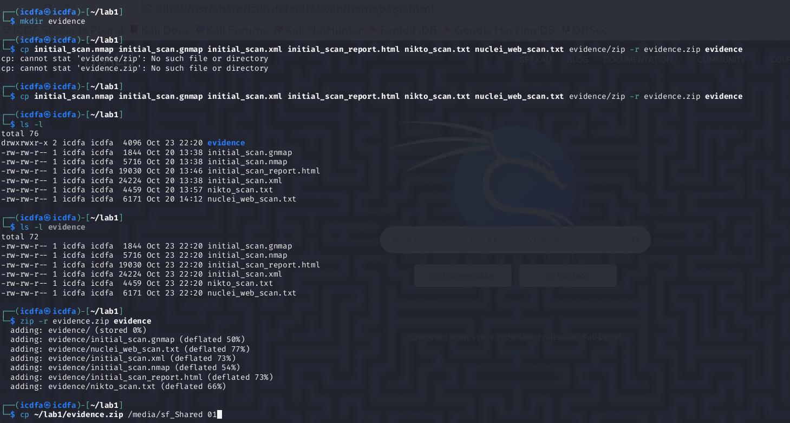

*Screenshot 22: The six output files (`initial_scan.gnmap`, `.nmap`, `.xml`, `initial_scan_report.html`, `nikto_scan.txt`, `nuclei_web_scan.txt`) copied into `evidence/` and zipped.*

### Checklist

| Required deliverable | Where it is |
|---|---|
| Nmap output files | [`initial_scan.nmap`](evidence/initial_scan.nmap), [`initial_scan.xml`](evidence/initial_scan.xml), [`initial_scan.gnmap`](evidence/initial_scan.gnmap) |
| Screenshot of the Nmap HTML report | [Screenshots 08 to 12](#nmap-html-report), and the report file itself: [`initial_scan_report.html`](evidence/initial_scan_report.html) |
| Nikto and Nuclei scan outputs | [`nikto_scan.txt`](evidence/nikto_scan.txt) and [`nuclei_web_scan.txt`](evidence/nuclei_web_scan.txt), with screenshots [13 to 14](#nikto) and [19 to 21](#step-5-focused-vulnerability-scanning-with-nuclei) |
| Completed risk assessment table | [Section 5](#5-phase-3-risk-assessment-step-6) |
| Executive summary | [Section 6](#6-executive-summary-step-7) |

```
