# Advanced Cybersecurity Risk Quantification

**Scenario:** SecureBank Financial, SecureMobile banking platform   
**Author:** Adaeze Elizabeth Adeteye   
**Student ID:** C11/26/CGRCE/1756
**Role in the scenario:** Lead GRC analyst, reporting to the CISO and CFO

In this lab I turned three critical penetration-test findings into dollar figures, tested three security controls against them, and wrote up an executive recommendation. Everything is calculated in an Excel workbook with live formulas, and I cross-checked the results with a short Python model. This README walks through the work task by task.

---

## Contents

1. [Summary of results](#1-summary-of-results)
2. Deliverables]([#2-Deliverables](url))
3. [Scenario and dataset](#3-scenario-and-dataset)
4. [Method and formulas](#4-method-and-formulas)
5. [Phase 1: Risk exposure](#5-phase-1-risk-exposure)
6. [Phase 2: Control evaluation](#6-phase-2-control-evaluation)
7. [Phase 3: Executive reporting](#7-phase-3-executive-reporting)
8. [Bonus: optimal control selection under a budget](#8-bonus-optimal-control-selection-under-a-budget)
9. [Recommendations](#9-recommendations)
10. [Assumptions and limitations](#10-assumptions-and-limitations)

---

## 1. Summary of results

| Measure | Result |
|---|---|
| Total annual exposure (sum of ALE) | **$35,000,000** |
| Largest risk | Database Injection, **$31,250,000** ALE (89% of total) |
| Annual risk reduction from all three controls | **$26,962,500** (77%) |
| Residual annual exposure after controls | **$8,037,500** |
| Year-1 investment (initial + first-year maintenance) | **$805,000** |
| Portfolio Year-1 ROI | **3,249%** |
| Highest-return control | WAF, Year-1 ROI 13,293% |
| Weakest-return control | API Security Gateway, Year-1 ROI 69% |

**My recommendation in one line:** deploy the WAF and fix the injection flaw in code immediately, roll out enhanced MFA within 90 days, and deliver the API gateway over the following months. Even with all three controls in place, $8,037,500 of annual exposure remains, so the controls do not replace root-cause fixes and monitoring.

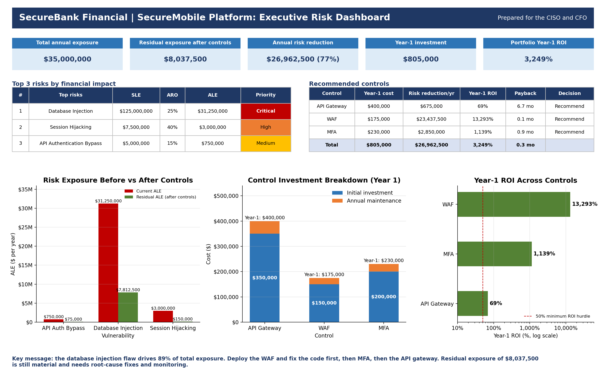

---

## 2. Deliverables
How each lab deliverable maps to a file:

| Lab deliverable | Where to find it |
|---|---|
| Completed risk calculations (ALE for all vulnerabilities) | [Section 5](#task-1-annualized-loss-expectancy-ale), workbook tab *Risk Calc*, [data/risk_matrix.csv](data/risk_matrix.csv) |
| Risk prioritization matrix | [Section 5, Task 2](#task-2-risk-prioritization-matrix) |
| Control analysis worksheet (cost-benefit, ROI) | [Section 6, Task 4](#task-4-cost-benefit-analysis), workbook tab *Control Analysis*, [data/control_cost_benefit.csv](data/control_cost_benefit.csv) |
| Risk exposure chart (bar and pie) | [charts/01_ale_bar_chart.png](charts/01_ale_bar_chart.png), [charts/02_risk_distribution_pie_chart.png](charts/02_risk_distribution_pie_chart.png) |
| Control effectiveness comparison (scatter) | [charts/04_cost_vs_effectiveness_scatter.png](charts/04_cost_vs_effectiveness_scatter.png) |
| ROI visualization (horizontal bar) | [charts/05_roi_comparison_horizontal_bar.png](charts/05_roi_comparison_horizontal_bar.png) |
| Risk reduction timeline (line graph) | [charts/06_risk_reduction_timeline.png](charts/06_risk_reduction_timeline.png) |
| Investment breakdown (stacked bar) | [charts/08_investment_breakdown_stacked_bar.png](charts/08_investment_breakdown_stacked_bar.png) |
| Risk heat map | [charts/03_risk_heat_map.png](charts/03_risk_heat_map.png) |
| One-page dashboard | [charts/10_executive_dashboard.png](charts/10_executive_dashboard.png), page 1 of the [PDF briefing](reports/Lab3b_Executive_Briefing.pdf) |
| Risk treatment plan with Gantt chart | [Section 7, Task 7](#task-7-risk-treatment-timeline), [charts/09_risk_treatment_gantt.png](charts/09_risk_treatment_gantt.png) |
| Financial justification with graphs | Page 3 of the [PDF briefing](reports/Lab3b_Executive_Briefing.pdf) |
| Bonus: combined risk-control matrix and budget selection | [Section 8](#8-bonus-optimal-control-selection-under-a-budget) |

---

## 3. Scenario and dataset

I am the lead GRC analyst at SecureBank Financial. The CISO gave me results from a penetration test and vulnerability assessment of the new SecureMobile banking platform (500,000 active customers, 50,000 transactions a day, $2,500 average transaction). My job is to quantify the financial risk, evaluate control options and prepare an executive briefing.

**Findings**

| # | Finding | Exploit probability | System affected | Impact data |
|---|---|---|---|---|
| 1 | API Authentication Bypass | 15% | Transaction processing | Maximum single-incident loss $5,000,000; estimated detection 48 hours |
| 2 | Database Injection | 25% | Customer database | 500,000 records at $250 per record (regulatory and notification) |
| 3 | Session Hijacking | 40% | User sessions | 5,000 accounts at $1,500 average loss per account |

**Control options**

| # | Control | Initial cost | Effectiveness | Annual maintenance |
|---|---|---|---|---|
| 1 | Advanced API Security Gateway | $350,000 | 90% reduction in API vulnerabilities | $50,000 |
| 2 | Web Application Firewall (WAF) | $150,000 | 75% reduction in web vulnerabilities | $25,000 |
| 3 | Multi-Factor Authentication Enhancement | $200,000 | 95% reduction in account takeover | $30,000 |

---

## 4. Method and formulas

| Measure | Formula |
|---|---|
| Single Loss Expectancy (SLE) | Cost of one incident |
| Annual Rate of Occurrence (ARO) | Exploit probability as a decimal, read as the expected number of incidents per year |
| Annualized Loss Expectancy (ALE) | SLE × ARO |
| Annual risk reduction | ALE of the finding the control addresses × control effectiveness |
| Year-1 cost | Initial investment + one year of maintenance |
| ROI | (Risk reduction − cost) ÷ cost |
| Payback period | Initial investment ÷ (annual risk reduction − annual maintenance) |
| Residual ALE | ALE − annual risk reduction |

**Control-to-finding mapping.** The lab does not say which control covers which finding, so I mapped them by what each control actually defends against:

- API Security Gateway covers Finding 1 (API authentication bypass)
- WAF covers Finding 2 (injection arrives through the web and application layer)
- MFA Enhancement covers Finding 3 (session hijacking leads to account takeover)

---

## 5. Phase 1: Risk exposure

### Task 1: Annualized Loss Expectancy (ALE)

**Finding 1, API Authentication Bypass**
- SLE = $5,000,000 (the stated maximum single-incident loss)
- ARO = 0.15
- ALE = 5,000,000 × 0.15 = **$750,000**

**Finding 2, Database Injection**
- SLE = 500,000 records × $250 = $125,000,000
- ARO = 0.25
- ALE = 125,000,000 × 0.25 = **$31,250,000**

**Finding 3, Session Hijacking**
- SLE = 5,000 accounts × $1,500 = $7,500,000
- ARO = 0.40
- ALE = 7,500,000 × 0.40 = **$3,000,000**

**Total ALE** = 750,000 + 31,250,000 + 3,000,000 = **$35,000,000** per year.

### Task 2: Risk prioritization matrix

| Rank | Vulnerability | SLE | ARO | ALE | Share of total | Risk priority |
|---|---|---|---|---|---|---|
| 1 | Database Injection | $125,000,000 | 25% | $31,250,000 | 89.3% | **Critical** |
| 2 | Session Hijacking | $7,500,000 | 40% | $3,000,000 | 8.6% | **High** |
| 3 | API Authentication Bypass | $5,000,000 | 15% | $750,000 | 2.1% | **Medium** |

The lab does not set priority thresholds, so I chose my own and kept them in one place in the workbook (*Inputs* tab) so they can be changed:

| Priority | ALE threshold |
|---|---|
| Critical | $10,000,000 or more |
| High | $1,000,000 to $9,999,999 |
| Medium | $500,000 to $999,999 |
| Low | Below $500,000 |

Database Injection is 10.4 times larger than the next risk and makes up 89% of all exposure. That is why it drives the sequencing of everything that follows.

The full table is also in [data/risk_matrix.csv](data/risk_matrix.csv).

### Task 3: Risk visualizations

**Bar chart: ALE by vulnerability**

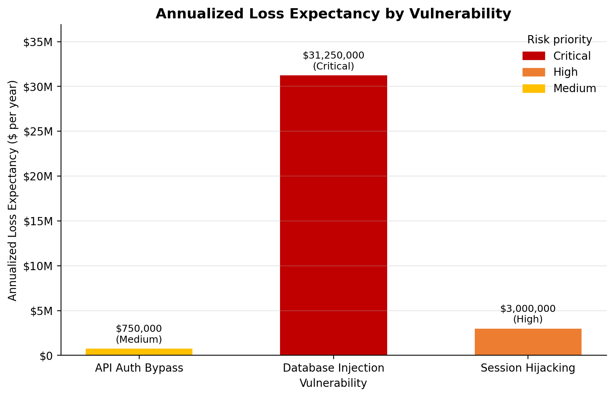

**Pie chart: risk distribution**

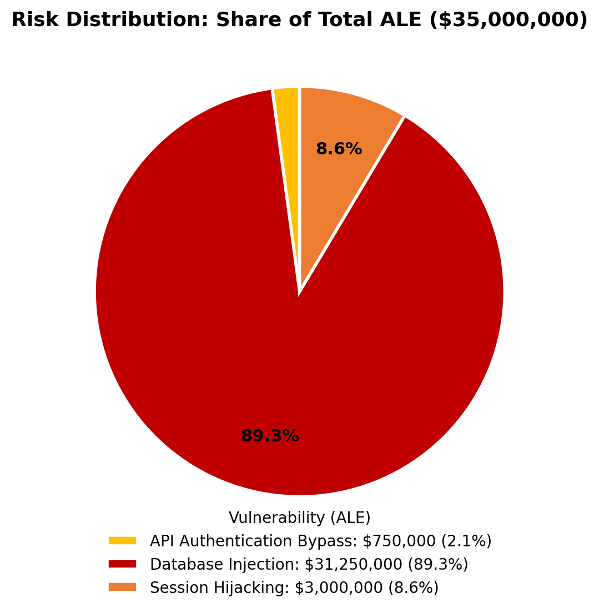

**Heat map: probability against impact**

For the heat map I rated each finding on probability (High at 30% or more, Medium at 15% to 30%, Low below 15%) and on impact using SLE (High at $50M or more, Medium at $5M to $50M, Low below $5M). I scored each level 1 to 3 and added the two scores: 5 or more is High risk, 4 is Medium, 3 or less is Low.

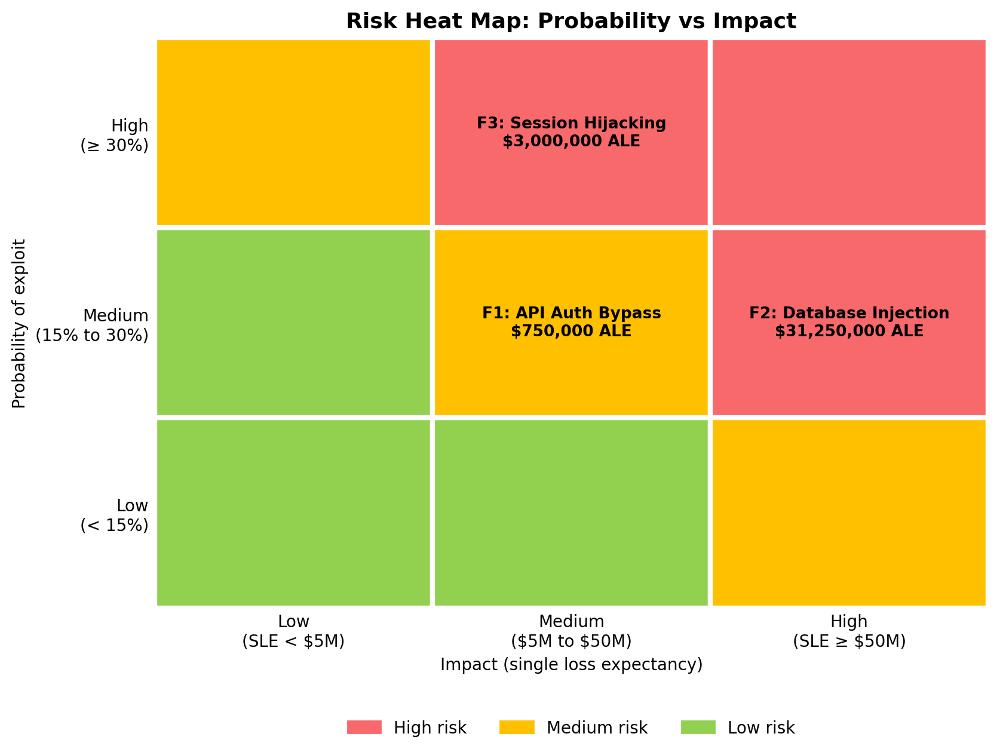

| Finding | Probability | Impact | Heat rating |
|---|---|---|---|
| F1: API Authentication Bypass | Medium (15%) | Medium ($5,000,000) | **Medium** |
| F2: Database Injection | Medium (25%) | High ($125,000,000) | **High** |
| F3: Session Hijacking | High (40%) | Medium ($7,500,000) | **High** |

The heat map and the ALE ranking give the same order: Database Injection first, Session Hijacking second, API Authentication Bypass third. The heat map rates Session Hijacking High because it has the highest probability of the three (40%), even though its SLE is far below Database Injection's.

---

## 6. Phase 2: Control evaluation

### Task 4: Cost-benefit analysis

**Worked calculations**

*API Security Gateway (Finding 1, target ALE $750,000)*
- Risk reduction = 750,000 × 0.90 = **$675,000** per year
- Year-1 cost = 350,000 + 50,000 = **$400,000**
- Year-1 ROI = (675,000 − 400,000) ÷ 400,000 = **69%**
- Payback = 350,000 ÷ (675,000 − 50,000) = 0.56 years = **6.7 months**

*Web Application Firewall (Finding 2, target ALE $31,250,000)*
- Risk reduction = 31,250,000 × 0.75 = **$23,437,500** per year
- Year-1 cost = 150,000 + 25,000 = **$175,000**
- Year-1 ROI = (23,437,500 − 175,000) ÷ 175,000 = **13,293%**
- Payback = 150,000 ÷ (23,437,500 − 25,000) = 0.0064 years = **0.08 months (about 2 days)**

*Multi-Factor Authentication Enhancement (Finding 3, target ALE $3,000,000)*
- Risk reduction = 3,000,000 × 0.95 = **$2,850,000** per year
- Year-1 cost = 200,000 + 30,000 = **$230,000**
- Year-1 ROI = (2,850,000 − 230,000) ÷ 230,000 = **1,139%**
- Payback = 200,000 ÷ (2,850,000 − 30,000) = 0.071 years = **0.85 months (about 26 days)**

**Summary table**

| Control | Initial investment | Annual maintenance | Annual risk reduction | Year-1 cost | Year-1 ROI | Payback |
|---|---|---|---|---|---|---|
| Advanced API Security Gateway | $350,000 | $50,000 | $675,000 | $400,000 | 69% | 6.72 months |
| Web Application Firewall (WAF) | $150,000 | $25,000 | $23,437,500 | $175,000 | 13,293% | 0.08 months |
| Multi-Factor Authentication Enhancement | $200,000 | $30,000 | $2,850,000 | $230,000 | 1,139% | 0.85 months |
| **All three** | **$700,000** | **$105,000** | **$26,962,500** | **$805,000** | **3,249%** | **0.31 months** |

**Longer view (3 years) and break-even effectiveness**

| Control | 3-year cost | 3-year benefit | 3-year ROI | Effectiveness needed to break even in Year 1 | Effectiveness claimed |
|---|---|---|---|---|---|
| API Gateway | $500,000 | $2,025,000 | 305% | 53.3% | 90% |
| WAF | $225,000 | $70,312,500 | 31,150% | 0.6% | 75% |
| MFA | $290,000 | $8,550,000 | 2,848% | 7.7% | 95% |

The break-even column shows how much room there is for the vendor's effectiveness claim to be wrong. The WAF only needs to be 0.6% effective to pay for itself in Year 1, and MFA needs 7.7%. The API gateway needs 53%, so it is the only one where the investment case is sensitive to the effectiveness figure.

All three clear my 50% Year-1 ROI hurdle, so all three are recommended. The full table is in [data/control_cost_benefit.csv](data/control_cost_benefit.csv).

### Task 5: Control selection analysis

**Scatter plot: cost against effectiveness**

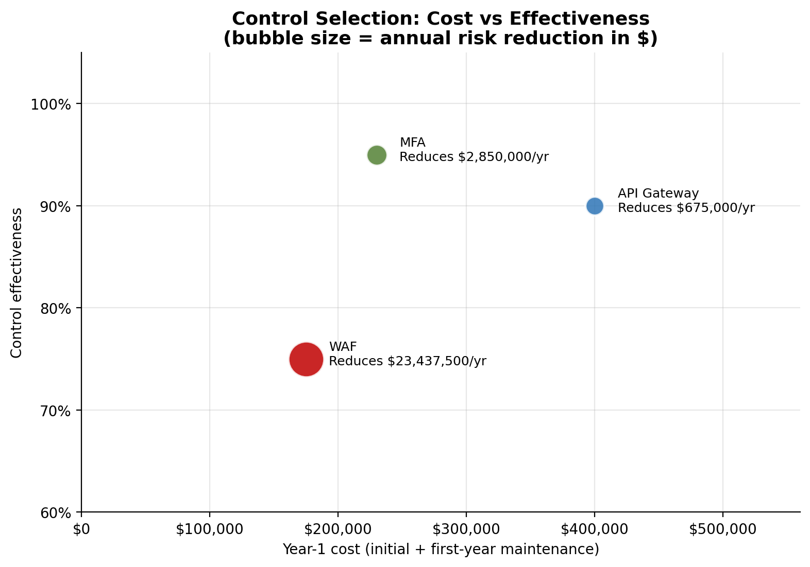

Effectiveness alone is misleading here. MFA scores highest at 95% and the WAF lowest at 75%, but the WAF removes by far the most dollars because it protects the largest exposure. The bubble size shows annual risk reduction.

**Horizontal bar chart: ROI comparison**

I used a log scale because the WAF's ROI is so large that a linear axis would make the other two bars unreadable.

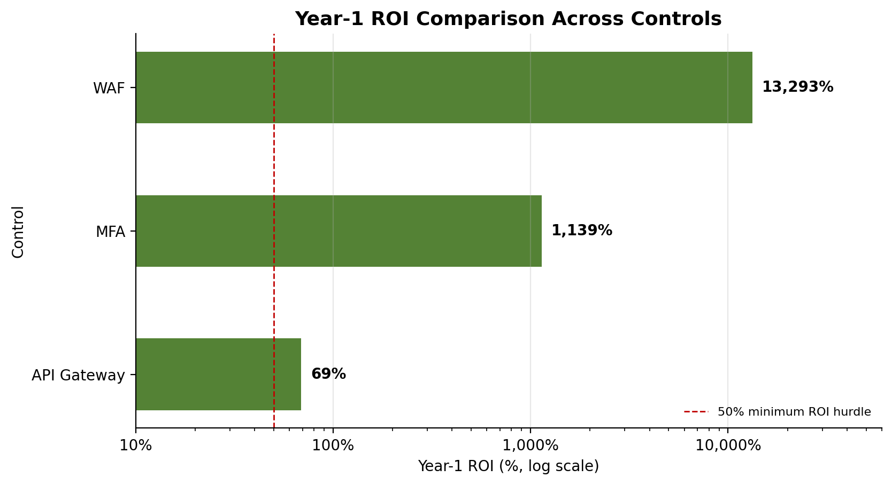

**Line graph: risk reduction over time**

The left panel shows cumulative net benefit (risk reduction minus all control costs) for each control over five years. The right panel compares cumulative expected loss with and without the controls.

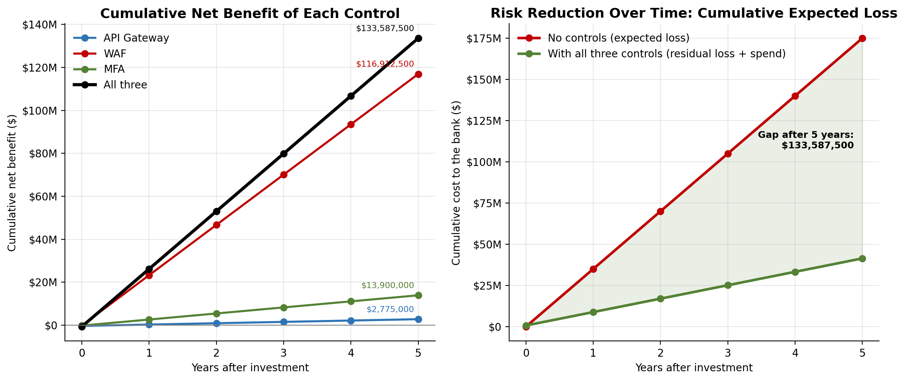

After five years the three controls have avoided about $133,587,500 of expected loss net of what they cost.

---

## 7. Phase 3: Executive reporting

### Task 6: Executive dashboard

The one-page dashboard has the top three risks, the recommended controls with costs, the expected risk reduction and the ROI. It also has the three required visualizations: exposure before and after controls (double bar), control investment breakdown (stacked bar) and ROI across controls (horizontal bar).

The three required charts are also available as standalone files:

**Risk exposure before and after controls (double bar chart)**

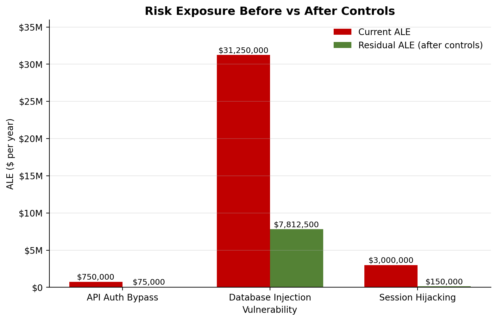

**Control investment breakdown (stacked bar chart)**

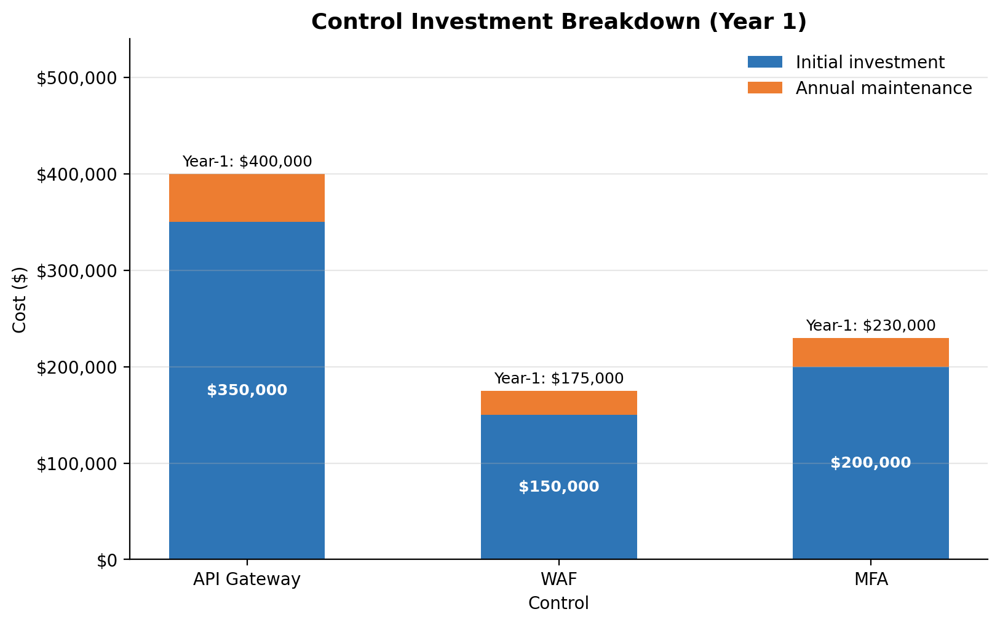

The ROI horizontal bar chart is the one in [Task 5](#task-5-control-selection-analysis).

### Task 7: Risk treatment timeline

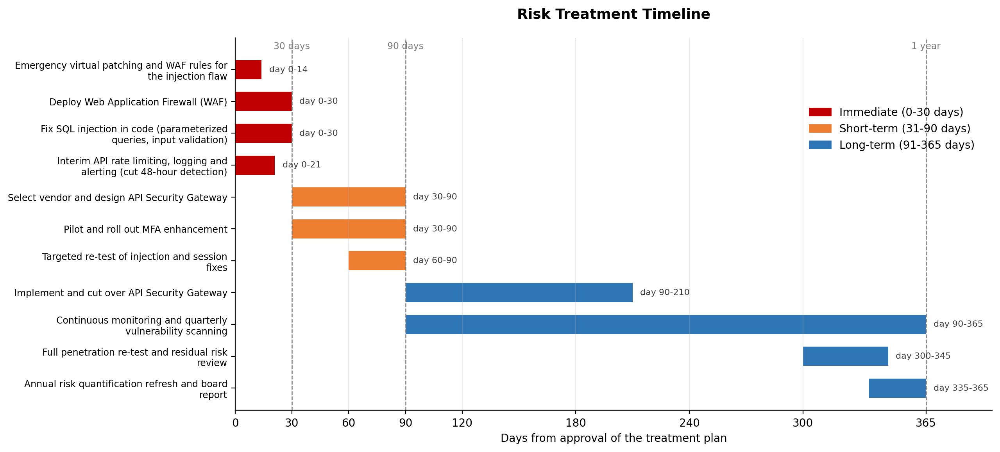

| Phase | Action | Finding addressed |
|---|---|---|
| Immediate (0-30 days) | Apply emergency virtual patching and WAF rules for the injection flaw | Finding 2 |
| Immediate (0-30 days) | Deploy the Web Application Firewall | Finding 2 |
| Immediate (0-30 days) | Fix SQL injection in code with parameterized queries and input validation | Finding 2 |
| Immediate (0-30 days) | Add interim API rate limiting, logging and alerting to cut the 48-hour detection time | Finding 1 |
| Short-term (31-90 days) | Select a vendor and design the API Security Gateway | Finding 1 |
| Short-term (31-90 days) | Pilot and roll out the MFA enhancement | Finding 3 |
| Short-term (31-90 days) | Targeted re-test of the injection and session fixes | Findings 2 and 3 |
| Long-term (91-365 days) | Implement and cut over the API Security Gateway | Finding 1 |
| Long-term (91-365 days) | Continuous monitoring and quarterly vulnerability scanning | All findings |
| Long-term (91-365 days) | Full penetration re-test and residual risk review | All findings |
| Long-term (91-365 days) | Annual risk quantification refresh and board report | All findings |

I ordered the work by financial impact, not by how easy each item is. The injection flaw accounts for 89% of exposure, so its fixes start on day one. The API gateway comes last among the controls because it has the lowest return, and the interim rate limiting and alerting covers Finding 1 while the gateway is selected and built.

The same material is in the [executive briefing PDF](reports/Lab3b_Executive_Briefing.pdf): page 1 is the dashboard, page 2 the treatment plan and page 3 the financial justification.

---

## 8. Bonus: optimal control selection under a budget

### Combined risk-control matrix

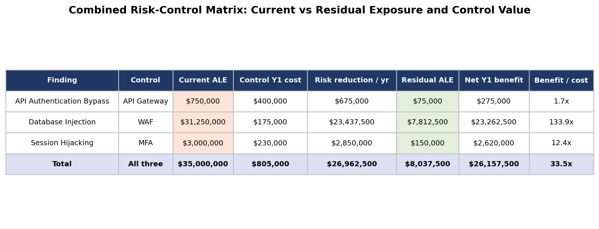

| Finding | Control | Current ALE | Residual ALE | Control Year-1 cost | Net Year-1 benefit | Benefit per $1 spent |
|---|---|---|---|---|---|---|
| API Authentication Bypass | API Gateway | $750,000 | $75,000 | $400,000 | $275,000 | 1.7 |
| Database Injection | WAF | $31,250,000 | $7,812,500 | $175,000 | $23,262,500 | 133.9 |
| Session Hijacking | MFA | $3,000,000 | $150,000 | $230,000 | $2,620,000 | 12.4 |
| **Total** | | **$35,000,000** | **$8,037,500** | **$805,000** | **$26,157,500** | **33.5** |

### Optimal selection

The lab does not give a budget, so I assumed a Year-1 budget of **$500,000** and tested all eight combinations of the three controls. For each one I calculated Year-1 cost, risk reduction and net benefit, then kept only the combinations that fit the budget and picked the highest net benefit.

| Option | Year-1 cost | Annual risk reduction | Net Year-1 benefit | Within $500,000? | Residual exposure |
|---|---|---|---|---|---|
| No controls | $0 | $0 | $0 | Yes | $35,000,000 |
| WAF | $175,000 | $23,437,500 | $23,262,500 | Yes | $11,562,500 |
| MFA | $230,000 | $2,850,000 | $2,620,000 | Yes | $32,150,000 |
| API Gateway | $400,000 | $675,000 | $275,000 | Yes | $34,325,000 |
| WAF + MFA | $405,000 | $26,287,500 | $25,882,500 | Yes | $8,712,500 |
| API Gateway + WAF | $575,000 | $24,112,500 | $23,537,500 | No | $10,887,500 |
| API Gateway + MFA | $630,000 | $3,525,000 | $2,895,000 | No | $31,475,000 |
| API Gateway + WAF + MFA | $805,000 | $26,962,500 | $26,157,500 | No | $8,037,500 |

**Optimal option at $500,000: WAF + MFA**, with a Year-1 cost of $405,000, a net benefit of $25,882,500 and a residual exposure of $8,712,500. The API gateway does not fit alongside the other two within this budget.

Because the budget is my assumption, I also checked how the answer changes at other budget levels:

| Year-1 budget | Best option | Year-1 cost | Net Year-1 benefit | Residual exposure |
|---|---|---|---|---|
| $150,000 | No controls | $0 | $0 | $35,000,000 |
| $175,000 | WAF | $175,000 | $23,262,500 | $11,562,500 |
| $230,000 | WAF | $175,000 | $23,262,500 | $11,562,500 |
| $405,000 | WAF + MFA | $405,000 | $25,882,500 | $8,712,500 |
| $575,000 | WAF + MFA | $405,000 | $25,882,500 | $8,712,500 |
| $805,000 | API Gateway + WAF + MFA | $805,000 | $26,157,500 | $8,037,500 |

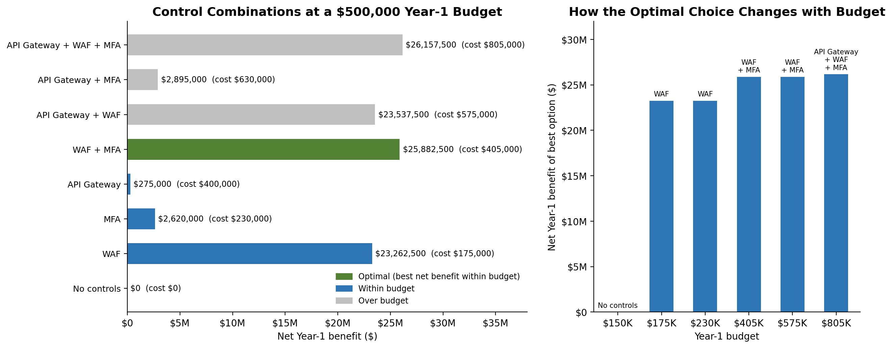

From $175,000 upward the WAF is always part of the optimal set. MFA is the next best addition, and the API gateway only becomes part of the optimal set once the budget reaches the full $805,000. At that level it adds about $275,000 of net Year-1 benefit over WAF + MFA, which is worthwhile but small next to what the first two controls deliver.

---

## 9. Recommendations

1. **Start with the WAF and a code fix for the injection flaw (days 0 to 30).** This is the single biggest reduction in risk: $23,437,500 per year for $175,000. Because a WAF is a compensating control, the underlying vulnerability still has to be fixed with parameterized queries and input validation.
2. **Roll out enhanced MFA within 90 days.** It cuts Session Hijacking exposure from $3,000,000 to $150,000 for $230,000.
3. **Approve the API Security Gateway as the third priority.** The return is positive (69% in Year 1, 305% over 3 years) but the lowest of the three. If funds are limited, defer it and use rate limiting, logging and alerting in the meantime.
4. **Reduce the 48-hour detection time for the API flaw.** Faster detection limits the size of any single loss, and the $5,000,000 loss figure may be understated (see the limitations below).
5. **Re-test and refresh the numbers.** Re-run the penetration test after the fixes and update the probabilities and effectiveness figures with real results.
6. **Report residual risk.** After all three controls, $8,037,500 of annual exposure remains, most of it ($7,812,500) from the injection flaw. The CFO and CISO should formally accept or further treat that amount.

---

## 10. Assumptions and limitations

**Assumptions**

- SLE for Finding 1 is the stated maximum single-incident loss; for Finding 2 it is records × cost per record; for Finding 3 it is accounts at risk × average loss per account.
- The exploit probability is used as the ARO, meaning one attempted exploitation per year at that likelihood.
- Each control is applied only to the finding it is mapped to. I did not credit any control with side benefits on other findings.
- The effectiveness percentages are taken as given and applied directly to the ALE.
- The risk priority thresholds, heat map thresholds, 50% ROI hurdle, 3-year horizon and $500,000 budget are my own assumptions, because the lab does not provide them. They are all editable on the workbook's *Inputs* tab.
- Costs are not discounted and inflation is ignored.

**Limitations**

- **Finding 1 may be understated.** With a 48-hour detection window and about $125,000,000 in daily transaction value (50,000 × $2,500), a successful attack could in principle move far more than $5,000,000 before it is detected. I used the stated maximum, so the ALE of $750,000 should be treated as a floor.
- **Finding 2 treats cost per record as the full breach cost.** It covers regulatory and notification cost as the lab states, and leaves out reputational damage, customer churn and litigation.
- **The WAF result depends on a large exposure.** Its ROI is very high because it is credited with 75% of a $31,250,000 exposure. A WAF can be bypassed, so the real-world reduction is likely lower than the quoted 75%, which is why the break-even check above matters.
- **Findings are treated as independent.** I did not model a single attacker chaining the vulnerabilities, so total exposure is a simple sum.
- **Controls are not tested in combination.** The residual figures assume each control works in isolation on its own finding.

---

